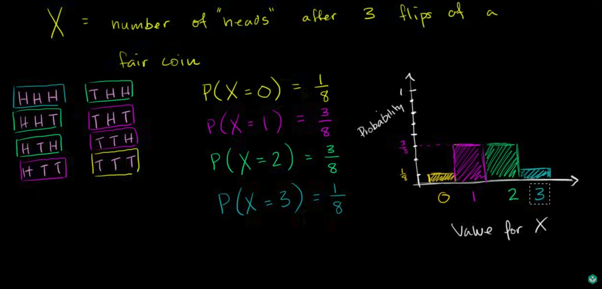
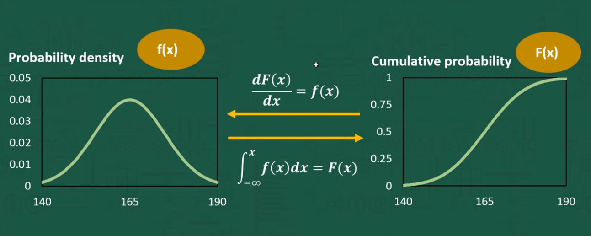

# Probability and Statistics - Comprehensive Course Notes (PNS)
*Compiled by Muhammad Murtaza (mm09736)*

## Table of Contents
- [1. Core Fundamentals & Axioms (Weeks 1 & 2)](#1-core-fundamentals--axioms-weeks-1--2)
  - [Probabilistic Models](#probabilistic-models)
  - [The Three Axioms of Probability](#the-three-axioms-of-probability)
  - [Important Theorems & Proofs](#important-theorems--proofs)
- [2. Conditional Probability & The Multiplication Rule (Week 3)](#2-conditional-probability--the-multiplication-rule-week-3)
  - [Conditional Probability](#conditional-probability)
  - [The Multiplication (Product) Rule](#the-multiplication-product-rule)
- [3. Independence vs. Dependence (Week 4)](#3-independence-vs-dependence-week-4)
  - [Basic Independence (Two Events)](#basic-independence-two-events)
  - [Pairwise vs. Mutual Independence (Three Events)](#pairwise-vs-mutual-independence-three-events)
- [4. Bayes' Theorem & Total Probability](#4-bayes-theorem--total-probability)
  - [Deriving Bayes' Theorem](#deriving-bayes-theorem)
  - [The Law of Total Probability](#the-law-of-total-probability)
  - [Using Tree Diagrams (Dependent vs. Independent Events)](#using-tree-diagrams-dependent-vs-independent-events)
  - [Famous Examples of Bayes' Theorem](#famous-examples-of-bayes-theorem)
- [5. Counting, Permutations & Combinations (Week 5)](#5-counting-permutations--combinations-week-5)
  - [The Intuition Behind Permutations & Combinations](#the-intuition-behind-permutations--combinations)
  - [Binomial Probabilities](#binomial-probabilities)
  - [Partitions & Multinomial Coefficients](#partitions--multinomial-coefficients)
- [6. Random Variables & Probability Distributions (PMF, PDF, CDF)](#6-random-variables--probability-distributions-pmf-pdf-cdf)
  - [Random Variables (RVs)](#random-variables-rvs)
  - [Discrete vs. Continuous Random Variables](#discrete-vs-continuous-random-variables)
  - [Probability Mass Function (PMF) — Discrete Distributions](#probability-mass-function-pmf--discrete-distributions)
  - [Probability Density Function (PDF) — Continuous Distributions [Post-Midterm]](#probability-density-function-pdf--continuous-distributions-post-midterm)
  - [Cumulative Distribution Function (CDF) — Both Discrete & Continuous](#cumulative-distribution-function-cdf--both-discrete--continuous)
  - [Connecting PDF and CDF: The Calculus & Gradient Relationship [Post-Midterm]](#connecting-pdf-and-cdf-the-calculus--gradient-relationship-post-midterm)
  - [Continuous 2D Sample Spaces: The Romeo and Juliet Problem [Post-Midterm]](#continuous-2d-sample-spaces-the-romeo-and-juliet-problem-post-midterm)
- [7. Expectation (Mean), Variance & Moments (Weeks 6 & 7)](#7-expectation-mean-variance--moments-weeks-6--7)
  - [Expected Value (Mean $\mu$)](#expected-value-mean)
  - [Variance and Standard Deviation](#variance-and-standard-deviation)
- [8. Common Discrete Random Variable Distributions](#8-common-discrete-random-variable-distributions)
  - [1. Bernoulli Distribution](#1-bernoulli-distribution)
  - [2. Binomial Distribution](#2-binomial-distribution)
  - [3. Geometric Distribution](#3-geometric-distribution)
  - [4. Discrete Uniform Distribution](#4-discrete-uniform-distribution)
  - [5. Poisson Distribution](#5-poisson-distribution)
- [9. Multiple Discrete Random Variables: Joint PMFs, Conditioning & Independence](#9-multiple-discrete-random-variables-joint-pmfs-conditioning--independence)
  - [Curated Video Resource Hub](#curated-video-resource-hub)
  - [1. Joint Probability Mass Functions (Joint PMF)](#1-joint-probability-mass-functions-joint-pmf)
  - [2. Marginal PMFs ("Squashing" the Table)](#2-marginal-pmfs-squashing-the-table)
  - [3. Conditioning with Random Variables](#3-conditioning-with-random-variables)
  - [4. Independence of Random Variables](#4-independence-of-random-variables)
  - [5. Functions of Multiple Random Variables & 2D LOTUS](#5-functions-of-multiple-random-variables--2d-lotus)
  - [6. Independence, Expectation & Variance (Classic Exam Traps!)](#6-independence-expectation--variance-classic-exam-traps)
- [10. Vocabulary Glossary](#10-vocabulary-glossary)

## Index of Proofs
- [Proof 1 (De Morgan's Laws)](#proof-1)
- [Proof 2 (Probability of a Complement)](#proof-2)
- [Proof 3 (The Addition Rule)](#proof-3)
- [Proof 4 (The Union Bound)](#proof-4)

---

## 1. Core Fundamentals & Axioms (Weeks 1 & 2)

### Probabilistic Models
Every probabilistic model has an underlying *experiment* and involves:
*   **Sample Space ($\Omega$):** The set of all possible outcomes. These outcomes must be mutually exclusive and collectively exhaustive.
*   **Probability Law:** A rule that assigns a non-negative number $P(A)$ to an event $A$, representing its likelihood.

**Types of Sample Spaces:**
*   **Discrete and Finite:** e.g., rolling a die $\{1, 2, 3, 4, 5, 6\}$.
*   **Discrete and Infinite (Countably Infinite):** e.g., flipping a coin until you get a tail $\{1, 2, 3, \dots\}$.
*   **Continuous (Uncountably Infinite):** e.g., throwing a dart at a unit square.

### The Three Axioms of Probability
Everything in probability is built upon these three mathematical rules:
1.  **Nonnegativity:** $P(A) \geq 0$
2.  **Normalization:** $P(\Omega) = 1$ (The probability of *some* outcome occurring is 100%).
3.  **Additivity:** If events $A$ and $B$ are disjoint (mutually exclusive, meaning $A \cap B = \emptyset$), then $P(A \cup B) = P(A) + P(B)$.

### Important Theorems & Proofs

<a id="proof-1"></a><mark>Proof 1 (De Morgan's Laws):</mark>
**Statement 1:** $(A \cup B)^c = A^c \cap B^c$ (The complement of a union is the intersection of the complements).
*   <mark style="background-color: lightgreen;">Proof</mark> **(Subset definition):**
    To prove two sets are equal, we must show that they are subsets of each other.
    1.  Let $x \in (A \cup B)^c$. This means $x$ is not in $(A \cup B)$.
    2.  Therefore, $x$ is not in $A$ and $x$ is not in $B$.
    3.  This means $x \in A^c$ and $x \in B^c$, so $x \in (A^c \cap B^c)$. Thus, $(A \cup B)^c \subseteq (A^c \cap B^c)$.
    4.  Conversely, let $x \in (A^c \cap B^c)$. Then $x \in A^c$ and $x \in B^c$.
    5.  This means $x \notin A$ and $x \notin B$, so $x \notin (A \cup B)$. Thus $x \in (A \cup B)^c$.
    6.  Therefore, $(A^c \cap B^c) \subseteq (A \cup B)^c$. Since both are subsets of each other, $(A \cup B)^c = A^c \cap B^c$.

<a id="proof-2"></a><mark>Proof 2 (Probability of a Complement and $P(A) \leq 1$):</mark>
**Statement:** $P(A) = 1 - P(A^c)$
*   <mark style="background-color: lightgreen;">Proof:</mark>
    1.  For any event $A$, we can split the sample space $\Omega$ into two disjoint sets: $A$ and its complement $A^c$. Thus, $A \cup A^c = \Omega$.
    2.  Because $A$ and $A^c$ are disjoint, we apply the **Additivity Axiom**: $P(A \cup A^c) = P(A) + P(A^c)$.
    3.  By the **Normalization Axiom**, $P(\Omega) = 1$. Therefore, $P(A) + P(A^c) = 1$.
    4.  Rearranging our equation gives $P(A) = 1 - P(A^c)$.
    5.  *(Extension)* By the **Nonnegativity Axiom**, $P(A^c) \geq 0$. Since we are subtracting a positive number (or zero) from 1, $P(A)$ must be $\leq 1$.

<a id="proof-3"></a><mark>Proof 3 (The Addition Rule):</mark>
**Statement:** $P(A \cup B) = P(A) + P(B) - P(A \cap B)$
*   <mark style="background-color: lightgreen;">Proof</mark> **(Using disjoint sets):**
    We break the events into smaller disjoint sets so we can use the Additivity axiom.
    Let:
    *   $a = P(A \cap B^c)$ (The part of A not in B)
    *   $b = P(A \cap B)$ (The overlap)
    *   $c = P(B \cap A^c)$ (The part of B not in A)
    
    1.  $A$ is made of two disjoint pieces: $A = (A \cap B^c) \cup (A \cap B)$. So, $P(A) = a + b$.
    2.  $B$ is made of two disjoint pieces: $B = (B \cap A^c) \cup (A \cap B)$. So, $P(B) = c + b$.
    3.  The union $A \cup B$ is made of all three disjoint pieces: $P(A \cup B) = a + b + c$.
    4.  Now, let's calculate $P(A) + P(B) - P(A \cap B)$:
        $(a + b) + (c + b) - b = a + b + c$.
    5.  Because both sides equal $a + b + c$, we have proven that $P(A \cup B) = P(A) + P(B) - P(A \cap B)$.

<a id="proof-4"></a><mark>Proof 4 (The Union Bound):</mark>
**Statement:** $P(A \cup B) \leq P(A) + P(B)$
*   <mark style="background-color: lightgreen;">Proof:</mark>
    1.  From the Addition Rule proof above, we know $P(A \cup B) = P(A) + P(B) - P(A \cap B)$.
    2.  By the **Nonnegativity Axiom**, $P(A \cap B) \geq 0$.
    3.  If we remove a non-negative term from the right side of the equation, the right side becomes larger (or stays equal if the term was 0).
    4.  Therefore, $P(A \cup B) \leq P(A) + P(B)$.

---

## 2. Conditional Probability & The Multiplication Rule (Week 3)

### Conditional Probability
This is the probability of an event $A$ happening, *given* that we already know event $B$ has happened. When we know $B$ occurred, our sample space shrinks to just $B$.
*   <mark style="background-color: lightblue;">**Formula:**</mark> $P(A|B) = \frac{P(A \cap B)}{P(B)}$ (assuming $P(B) \neq 0$)

### The Multiplication (Product) Rule
By rearranging the conditional probability formula, we can find the probability of multiple events happening sequentially.
*   **For two events:** $P(A \cap B) = P(A) \cdot P(B|A)$
*   **For three events:** $P(A \cap B \cap C) = P(A) \cdot P(B|A) \cdot P(C|A \cap B)$
    *   *Algebraic Intuition:* You start with the probability of the first event $P(A)$. Then, you multiply it by the probability of the second event happening *given* the first occurred $P(B|A)$. Finally, multiply by the probability of the third event happening *given* both the first and second occurred $P(C|A \cap B)$.
*   **For $n$ events (General Multiplication Rule):** 
    <mark style="background-color: lightblue;">$$P(A_1 \cap A_2 \cap \dots \cap A_n) = P(A_1) \cdot P(A_2|A_1) \cdot P(A_3|A_1 \cap A_2) \cdots P(A_n|A_1 \cap A_2 \cap \dots \cap A_{n-1})$$</mark>
    *   *Intuition:* You just keep chaining the probabilities. Each new event is conditioned on *all* the previous events having already happened.

---

## 3. Independence vs. Dependence (Week 4)

### Basic Independence (Two Events)
Two events are **independent** if the occurrence of one doesn't change the probability of the other. 
*   **Mathematical Definition:** $P(A|B) = P(A)$. In plain English: "The probability of A happening, even if I tell you B just happened, is still just the normal probability of A."
*   **Intersection of Independent Events:** If they are independent, finding the chance of both happening is simple multiplication: $P(A \cap B) = P(A) \cdot P(B)$.
*   **Example:** Flipping a coin (Event A) and rolling a die (Event B). The coin landing on Heads doesn't physically change the die to make rolling a 6 more or less likely. They are independent.

### Pairwise vs. Mutual Independence (Three Events)
Why isn't it enough for 3 events to just be independent in pairs? Let's use a classic trick question.

Imagine flipping **two normal coins**:
*   **Event A:** The 1st coin is Heads. ($P(A) = 0.5$)
*   **Event B:** The 2nd coin is Heads. ($P(B) = 0.5$)
*   **Event C:** The two coins **match** (both Heads or both Tails). ($P(C) = 0.5$)

**1. Checking Pairwise Independence:**
*   **A and B:** The first coin doesn't affect the second coin. (Independent)
*   **A and C:** If the 1st coin is Heads, the 2nd coin still has a 50/50 chance of landing on Heads to make a match. The chance of a match is still 50%. (Independent)
*   **B and C:** Same logic. The 2nd coin being Heads doesn't change the 50/50 chance of a match. (Independent)
*   *Conclusion:* In pairs, these events are perfectly independent!

**2. Checking Mutual (Full) Independence:**
What happens if we look at all three together? Suppose both **A and B happened** (1st is Heads AND 2nd is Heads).
What is the probability of **C** (the coins match) now? It is exactly **100%**.

Suddenly, Event C is completely dependent on A and B happening together. If they were truly mutually independent, knowing A and B wouldn't give you any clues about C.

**The Math Check for Mutual Independence:**
To be fully independent, this equation must hold true: $P(A \cap B \cap C) = P(A) \cdot P(B) \cdot P(C)$
*   **Left side (Reality):** The probability of A, B, and C all happening (1st Heads, 2nd Heads, AND they match) is just the probability of getting (Heads, Heads) = $1/4$.
*   **Right side (Multiplication):** $P(A) \cdot P(B) \cdot P(C) = (1/2) \cdot (1/2) \cdot (1/2) = 1/8$.

Because $1/4 \neq 1/8$, they are **not** fully mutually independent, even though they were pairwise independent!

---

## 4. Bayes' Theorem & Total Probability

Bayes' Rule allows us to "reverse" conditional probabilities. It is used to update the probability of a hypothesis after observing new evidence.

### Deriving Bayes' Theorem
We know from the Multiplication Rule that:
1.  $P(A \cap B) = P(A|B) \cdot P(B)$
2.  $P(B \cap A) = P(B|A) \cdot P(A)$

Since $P(A \cap B) = P(B \cap A)$, we can equate the right sides:
$P(A|B) \cdot P(B) = P(B|A) \cdot P(A)$

Dividing by $P(B)$ gives us **Bayes' Theorem**:
<mark style="background-color: lightblue;">$$P(A|B) = \frac{P(B|A) \cdot P(A)}{P(B)}$$</mark>

### The Law of Total Probability
To find the denominator $P(B)$ in Bayes' Theorem, we often use the Law of Total Probability. If we partition our sample space into disjoint events (like $A$ and $A^c$), then:
<mark style="background-color: lightblue;">$$P(B) = P(B \cap A) + P(B \cap A^c)$$</mark>
<mark style="background-color: lightblue;">$$P(B) = P(B|A)P(A) + P(B|A^c)P(A^c)$$</mark>

### Using Tree Diagrams (Dependent vs. Independent Events)
Tree diagrams are the best visual tool for calculating the Law of Total Probability and solving Bayes' Theorem problems. 
*   **The Rules of the Tree:** 
    1.  Multiply the probabilities *along* the branches to find the intersection (Multiplication Rule).
    2.  Add the results of different branch paths *together* to find the total probability of an outcome (Law of Total Probability).
*   **Visualizing Independence vs. Dependence:**
    *   **Independent Events:** If events are independent, the probabilities on the 2nd layer of branches will be *exactly the same* no matter which branch you took on the 1st layer. 
    *   **Dependent Events:** If events are dependent, the probabilities on the 2nd layer of branches will *change* based on the outcome of the 1st layer. 

### Famous Examples of Bayes' Theorem
**1. Medical Testing (False Positives):**
*   **The Scenario:** A disease affects 1% of the population. A test for the disease is 99% accurate. If you test positive, what is the probability you actually have the disease?
*   **The Intuition:** Most people guess 99%. But using Bayes' rule, the real answer is around 50%! Why? Because the disease is so rare. Out of 10,000 people, only 100 are sick. But 1% of the 9,900 healthy people will get false positives (99 people). So if you get a positive test, you are just as likely to be one of the 99 healthy people with a false positive as you are to be one of the 99 sick people with a true positive.
*   **The Math:** $P(\text{Sick}|\text{Pos}) = \frac{P(\text{Pos}|\text{Sick}) \cdot P(\text{Sick})}{P(\text{Pos})}$ (Where $P(\text{Pos})$ is found using a tree diagram/Total Probability).

**2. The Fire Alarm:**
*   **The Scenario:** A fire alarm goes off. What is the probability there is actually a fire? 
*   **The Intuition:** You must weigh the evidence. Fires are very rare ($P(\text{Fire})$ is low). False alarms (due to burnt toast or pranks) are relatively common. Bayes' theorem balances the high probability of the alarm going off *if* there's a fire $P(\text{Alarm}|\text{Fire})$ against the base rate of fires occurring vs. false alarms occurring.

---

## 5. Counting, Permutations & Combinations (Week 5)

### The Intuition Behind Permutations & Combinations
Instead of just memorizing the formulas, it is incredibly helpful to understand *why* they work from the ground up, using real-world scenarios. 
*(These examples are drawn from this highly recommended [video on Permutations and Combinations](https://youtu.be/s_LfN4ItCs4?si=UZarpyPeuJbLF8zs))*

**1. The Fundamental Counting Principle (Repetitive Permutations)**
<mark style="background-color: lightgreen;">Example: Outfits and Shoes</mark>
*   Imagine you have 3 pants and 4 shirts. Because each shirt can be worn with each pair of pants, you multiply the options together: $3 \times 4 = 12$ different outfits.
*   If you add 2 pairs of shoes, you multiply again: $12 \times 2 = 24$ possible outfits. This multiplying out of possibilities is the **counting principle**.

<mark style="background-color: lightgreen;">Example: Combination Lock</mark>
*   Consider a lock with 5 slots, where each slot has 10 possible numbers (0-9).
*   Because you *can* repeat numbers (e.g., 1-1-1-1-1 is valid), you use the counting principle: $10 \times 10 \times 10 \times 10 \times 10 = 10^5 = 100,000$ possible combinations.

**2. Permutations Without Repetition (Factorials)**
<mark style="background-color: lightgreen;">Example: Drawing Cards</mark>
*   Once a card is drawn from a deck and placed elsewhere, it cannot be drawn again. Every time you make a choice, you have *one less option* than the previous time. This pattern looks like: $n \times (n-1) \times (n-2) \dots$

<mark style="background-color: lightgreen;">Example: Computer Password</mark>
*   Suppose you are making a 4-space computer password using the 26 letters of the alphabet, and you *cannot* repeat letters.
*   **Slot 1:** 26 choices
*   **Slot 2:** 25 choices
*   **Slot 3:** 24 choices
*   **Slot 4:** 23 choices
*   The total number of choices is $26 \times 25 \times 24 \times 23 = 358,800$.

**3. Deriving the Permutation Formula**
*   Writing out $26 \times 25 \times 24 \times 23$ is tedious. We could use $26!$ (26 factorial), but that multiplies all the way down to 1 ($26 \times 25 \times \dots \times 1$). We only want the first 4 numbers!
*   To get rid of the remaining numbers ($22 \times 21 \times \dots \times 1$), we simply **divide them out**.
*   <mark style="background-color: lightblue;">$$\frac{26 \times 25 \times 24 \times 23 \times 22 \dots \times 1}{22 \times 21 \dots \times 1} = \frac{26!}{22!}$$</mark>
*   Where did 22 come from? It is the total number of choices (26) minus the number of slots (4). So, $22 = 26 - 4$.
*   <mark style="background-color: lightblue;">**Formula:**</mark> $_nP_r = \frac{n!}{(n-r)!}$ (where $n$ is the total items, $r$ is the number of slots).

**4. Combinations Without Repetition**
<mark style="background-color: lightgreen;">Example: Labeled Balls</mark>
*   **Permutations vs. Combinations:** In permutations, the order matters. In combinations, order does not matter.
*   Suppose you draw 3 balls labeled 1, 2, and 3. The sequence $3, 2, 1$ is a *different permutation* than $2, 3, 1$. However, they represent the *exact same combination* of balls.
*   *How many times did we overcount?* We overcounted by the number of ways you can arrange those $r$ specific balls. $r$ balls can be arranged in $r!$ ways (e.g., 3 balls arrange in $3! = 6$ ways).
*   To get the true number of unique combinations, we take our permutations formula and **divide it by $r!$** to remove the redundant orderings.
*   <mark style="background-color: lightblue;">**Formula:**</mark> $_nC_r = \frac{n!}{r!(n-r)!}$

### Binomial Coefficients & Probabilities
*(These examples and explanations are based on this [video on Binomial Coefficients](https://youtu.be/EKN51vLKves?si=hWpKSUyxN9hBS-3q))*

**The Binomial Coefficient Formula**
The formula for the binomial coefficient $\binom{n}{r}$, read as '$n$ choose $r$' or '$n$ above $r$', is:
<mark style="background-color: lightblue;">$$\binom{n}{r} = \frac{n!}{r!(n - r)!}$$</mark>
where $n \ge r$ and both are non-negative integers.

**Step-by-step Examples:**
1. **$\binom{8}{3}$**:
   *   Formula: $\frac{8!}{3!(8-3)!} = \frac{8!}{3!5!}$
   *   Calculation: $\frac{8 \times 7 \times 6 \times 5!}{ (3 \times 2 \times 1) \times 5!} = \frac{336}{6} = 56$
2. **$\binom{4}{0}$**:
   *   Formula: $\frac{4!}{0!(4-0)!} = \frac{4!}{0!4!}$
   *   Calculation: $\frac{4!}{1 \times 4!} = 1$
   *   *Note: Any binomial coefficient with $r=0$ equals 1.*
3. **$\binom{7}{5}$**:
   *   Formula: $\frac{7!}{5!(7-5)!} = \frac{7!}{5!2!}$
   *   Calculation: $\frac{7 \times 6 \times 5!}{5! \times (2 \times 1)} = \frac{42}{2} = 21$
4. **$\binom{9}{9}$**:
   *   Formula: $\frac{9!}{9!(9-9)!} = \frac{9!}{9!0!}$
   *   Calculation: $\frac{9!}{9! \times 1} = 1$
   *   *Note: When $n = r$, the result is always 1.*
5. **$\binom{9}{8}$**:
   *   Formula: $\frac{9!}{8!(9-8)!} = \frac{9!}{8!1!}$
   *   Calculation: $\frac{9 \times 8!}{8! \times 1} = 9$
6. **$\binom{5}{4}$**:
   *   Formula: $\frac{5!}{4!(5-4)!} = \frac{5!}{4!1!}$
   *   Calculation: $\frac{5 \times 4!}{4! \times 1} = 5$
   *   *Note: When $n$ is exactly one unit above $r$ (i.e. $n - r = 1$), the result is simply $n$.*

### Applying it to Binomial Probabilities
*(These examples are based on this [video on Binomial Distribution Probabilities](https://youtu.be/3PWKQiLK41M?si=LCJOI1t98GidKfiE))*
*(Note: For the formal Binomial Random Variable distribution, prerequisites, Excel functions, and the color blindness case study, see [Section 8.2 Binomial Distribution](#2-binomial-distribution)).*

Used when you have $n$ independent trials (like coin tosses), and you want exactly $x$ successes.
<mark style="background-color: lightblue;">$$P(x \text{ successes}) = \binom{n}{x} p^x (1-p)^{n-x}$$</mark>
*   $\binom{n}{x}$: (or $_nC_x$) The number of different ways/sequences those $x$ successes can be arranged.
*   $p^x$: The probability of $x$ successes happening ($p$ is the probability of success).
*   $q^{n-x}$ or $(1-p)^{n-x}$: The probability of the remaining failures happening ($q = 1-p$ is the probability of failure).

**Example 1: Die Roll Probability**
*   **Scenario:** A 6-sided die is rolled 12 times. What is the probability of rolling a '4' exactly 5 times?
*   **Variables:** $n = 12$ (trials), $x = 5$ (successes), $p = 1/6$ (probability of rolling a 4), $q = 5/6$ (probability of not rolling a 4).
*   <mark style="background-color: lightblue;">**Formula:**</mark> $P(5) = \binom{12}{5} (1/6)^5 (5/6)^{12-5}$
*   **Calculation:** $792 \times (1/6)^5 \times (5/6)^7 \approx 0.0284$ or $2.84\%$.

**Example 2: Multiple-Choice Test**
*   **Scenario:** A test has 20 questions with choices A, B, C, D. Probability of guessing exactly 6 correct?
*   **Variables:** $n = 20$, $x = 6$, $p = 1/4 = 0.25$, $q = 3/4 = 0.75$.
*   <mark style="background-color: lightblue;">**Formula:**</mark> $P(6) = \binom{20}{6} (0.25)^6 (0.75)^{14} \approx 16.86\%$.

**Example 3: Inequality ("Fewer Than")**
*   **Scenario:** 25% of students take algebra. Out of 30 students, what is the probability that *fewer than 5* are taking algebra?
*   **Logic:** "Fewer than 5" means calculating the exact probability for $x=0, 1, 2, 3,$ and $4$ students. *(Note: The video explicitly calculates for $x=1, 2, 3, 4$, but remember that $0$ is also fewer than 5! Always include $P(0)$ in these ranges).*
*   **Calculation:** You must find $P(0) + P(1) + P(2) + P(3) + P(4)$ by plugging each into the formula and adding them up.

**Mean and Standard Deviation of a Binomial Distribution**
If you know $n$ and $p$, you can quickly find the mean and standard deviation of the entire distribution:
*   **Mean ($\mu$):** $\mu = n \cdot p$ (e.g., $30 \times 0.25 = 7.5$)
*   **Standard Deviation ($\sigma$):** $\sigma = \sqrt{n \cdot p \cdot q}$ (e.g., $\sqrt{30 \times 0.25 \times 0.75} \approx 2.37$)

### Binomial Expansion & Pascal's Triangle
*(This section is based on this [video on Binomial Expansion and Pascal's Triangle](https://youtu.be/s19dWIHficY?si=hg_6FuOgwCO6luvn))*

**Pascal's Triangle**
Pascal's Triangle provides a quick way to find the coefficients for expanding binomials like $(a+b)^n$. Each number is the sum of the two numbers directly above it:
*   **Row 0:** 1
*   **Row 1:** 1, 1
*   **Row 2:** 1, 2, 1
*   **Row 3:** 1, 3, 3, 1
*   **Row 4:** 1, 4, 6, 4, 1
*   **Row 5:** 1, 5, 10, 10, 5, 1
*   **Row 6:** 1, 6, 15, 20, 15, 6, 1

**The Binomial Theorem (General Formula)**
*(From the [Khan Academy video](https://youtu.be/iPwrDWQ7hPc?si=GvL_eNmd--P4iXGM))*
While Pascal's triangle is great for small powers, the **Binomial Theorem** gives us the general mathematical formula to expand any binomial $(a+b)^n$ without needing to write out the whole triangle:
<mark style="background-color: lightblue;">$$(a+b)^n = \sum_{k=0}^{n} \binom{n}{k} a^{n-k} b^k$$</mark>
This formula simply says: add up all the terms from $k=0$ to $n$, where each term's coefficient is $\binom{n}{k}$ and the exponents on $a$ and $b$ always sum to $n$.

**Binomial Expansion Examples**
When expanding $(a+b)^n$, the exponent on $a$ starts at $n$ and decreases to $0$, while the exponent on $b$ starts at $0$ and increases to $n$. The coefficients can come either from the $n^{th}$ row of Pascal's triangle or by calculating $\binom{n}{k}$ for each term using the Binomial Theorem.

1.  **Expanding $(x + y)^5$ (Using the Binomial Theorem)**
    *   Here, $n=5$, $a=x$, $b=y$.
    *   We calculate the coefficients $\binom{5}{k}$ for $k=0$ through $5$:
        *   $k=0: \binom{5}{0} = 1$
        *   $k=1: \binom{5}{1} = 5$
        *   $k=2: \binom{5}{2} = 10$
        *   $k=3: \binom{5}{3} = 10$
        *   $k=4: \binom{5}{4} = 5$
        *   $k=5: \binom{5}{5} = 1$
    *   Result: $(x+y)^5 = 1x^5y^0 + 5x^4y^1 + 10x^3y^2 + 10x^2y^3 + 5x^1y^4 + 1x^0y^5$
    *   Simplified: $x^5 + 5x^4y + 10x^3y^2 + 10x^2y^3 + 5xy^4 + y^5$

2.  **Expanding $(x - 2)^3$**
    *   Uses Row 3 coefficients: 1, 3, 3, 1
    *   Expansion: $1(x)^3(-2)^0 + 3(x)^2(-2)^1 + 3(x)^1(-2)^2 + 1(x)^0(-2)^3$
    *   Result: $x^3 - 6x^2 + 12x - 8$

2.  **Expanding $(2x + 3y)^4$**
    *   Uses Row 4 coefficients: 1, 4, 6, 4, 1
    *   Expansion: $1(2x)^4(3y)^0 + 4(2x)^3(3y)^1 + 6(2x)^2(3y)^2 + 4(2x)^1(3y)^3 + 1(2x)^0(3y)^4$
    *   Result: $16x^4 + 96x^3y + 216x^2y^2 + 216xy^3 + 81y^4$

**Finding the $r^{th}$ Term Directly (Using the Binomial Theorem)**
Instead of writing out the entire expansion, you can find any specific term directly using the combinations formula:
<mark style="background-color: lightblue;">$$\text{Term} = \binom{n}{r} \times a^{(n-r)} \times b^r$$</mark>
*Note: In this specific formula for the term sequence, $r = (\text{term number} - 1)$. For example, to find the 4th term, $r = 3$.*

3.  **Finding the 4th term of $(3x - 4y)^6$**
    *   Here, $n=6$. Since we want the 4th term, $r = 4 - 1 = 3$.
    *   $a = 3x$ and $b = -4y$
    *   Formula: $\binom{6}{3} \times (3x)^{6-3} \times (-4y)^3$
    *   Calculation: $20 \times (27x^3) \times (-64y^3) = -34,560x^3y^3$

4.  **Finding the 5th term of $(3x - 4y)^6$**
    *   Here, $n=6$. Since we want the 5th term, $r = 5 - 1 = 4$.
    *   Formula: $\binom{6}{4} \times (3x)^{6-4} \times (-4y)^4$
    *   Calculation: $15 \times (9x^2) \times (256y^4) = 34,560x^2y^4$

### Partitions & Multinomial Coefficients
*(These examples and formulas are based on this [video on Multinomial Coefficients and Partitions](https://youtu.be/VGcx54CuNYc?si=snpCGIuH5PJByOTX))*

While the Binomial Theorem and binomial coefficients deal with splitting objects into *two* groups (chosen vs. not chosen), **multinomial coefficients** count the ways to split distinct objects into *any number* of groups.

**The General Multinomial Coefficient Formula:**
Suppose we have $n$ distinct objects and we want to split them into $m$ groups of sizes $k_1, k_2, \dots, k_m$. 
(Note: The group sizes must add up to the total number of objects: $\sum_{i=1}^{m} k_i = n$).
The number of ways to make such a selection is:
<mark style="background-color: lightblue;">$$\binom{n}{k_1, k_2, \dots, k_m} = \frac{n!}{k_1! \times k_2! \times \dots \times k_m!}$$</mark>

*   **Intuition:** The numerator $n!$ counts all possible ways to line up the $n$ distinct objects. The denominator divides out by the factorials of the group sizes because the order of the items *inside* any specific group does not matter.

**Example 1: Distributing Distinct Presents**
*   **Scenario:** You have 12 distinct presents and you want to give 3 to Person A, 4 to Person B, and 5 to Person C.
*   **Long Way (Combinations Product):** First choose 3 out of 12 for A: $\binom{12}{3}$. Then choose 4 out of the remaining 9 for B: $\binom{9}{4}$. The last 5 go to C: $\binom{5}{5}$. Total = $\binom{12}{3} \times \binom{9}{4} \times \binom{5}{5}$.
*   **Fast Way (Multinomial Formula):** $\frac{12!}{3! \times 4! \times 5!} = 27,720$ ways.

**Example 2: Anagrams with Identical Items ("Mississippi")**
*   **Scenario:** How many distinct rearrangements are there of the 11 letters in the word MISSISSIPPI?
*   **Logic:** There are 11 total blanks to fill. We need to choose 4 to be 'I's, 4 to be 'S's, 2 to be 'P's, and 1 to be the 'M'.
*   **Calculation:** $\frac{11!}{4! \times 4! \times 2! \times 1!} = 34,650$ distinct anagrams.

**The General Multinomial Theorem**
Just like binomial coefficients appear when expanding $(x+y)^n$, multinomial coefficients appear when expanding polynomials with more than two terms (like $(x+y+z)^n$).
<mark style="background-color: lightblue;">$$(x_1 + x_2 + \dots + x_m)^n = \sum \binom{n}{k_1, k_2, \dots, k_m} x_1^{k_1} x_2^{k_2} \dots x_m^{k_m}$$</mark>
*(The sum iterates over all possible non-negative integer values for the $k$'s that sum to $n$)*.

*   **Example Application:** Expanding $(x + y + z)^5$. What is the coefficient of the $x^2 y^2 z$ term?
*   **Calculation:** We need to choose 2 factors to contribute an $x$, 2 to contribute a $y$, and 1 to contribute a $z$. We use the formula with $n=5$, and $k_1=2, k_2=2, k_3=1$.
*   **Result:** The coefficient is $\binom{5}{2, 2, 1} = \frac{5!}{2! \times 2! \times 1!} = \frac{120}{4} = 30$.

---

## 6. Random Variables & Probability Distributions (PMF, PDF, CDF)

### Random Variables (RVs)
*(These concepts are based on this [video on Random Variables](https://youtu.be/3v9w79NhsfI?si=VP1zu_-rixweJoZw))*

Unlike traditional algebra variables that represent a single fixed unknown (e.g., $x+5=6 \implies x=1$), a **random variable** is a function that maps outcomes of a random process or experiment to numerical values ($\Omega \rightarrow \mathbb{R}$). They are conventionally written with capital letters, such as $X$, $Y$, or $Z$.
*   **Why use them?** Quantifying outcomes enables clean, powerful mathematical operations. Instead of writing long prose ("the probability that rolling seven dice yields a sum of 30 or less"), we simply write $P(Y \le 30)$.
*   **Examples:**
    *   **Coin Flip ($X$):** Define $X = 1$ if the result is *heads*, and $X = 0$ if *tails*.
    *   **Dice Roll ($Y$):** Define $Y$ as the sum of the upward-facing numbers when seven dice are rolled.
*   **Key Difference:** Algebraic variables are solved for a single value. Random variables take on whole distributions of potential values with varying probabilities.

---

### Discrete vs. Continuous Random Variables
*(These concepts are based on this [video on Discrete and Continuous Random Variables](https://youtu.be/dOr0NKyD31Q?si=MxM3iZdswM2vpbqd) and this [video on Discrete vs. Continuous RVs & PDFs](https://youtu.be/Fvi9A_tEmXQ?si=YTpLrftu669FTf_3))*

Random variables are broadly divided into two foundational classes:
1.  **Discrete Random Variables:**
    *   Variables that take on distinct, separate, countable values (often whole integers).
    *   *Examples:* Result of a coin flip ($0$ or $1$), birth year ($1998, 1999\dots$), number of heads in 10 tosses, number of defects in a batch.
2.  **Continuous Random Variables:**
    *   Variables that can take on *any* value within a continuous interval or continuum (infinitely many possible decimals).
    *   *Examples:* Rainfall tomorrow (e.g., $2.148\dots$ inches), human height (e.g., $165.387\dots$ cm), exact time to commute, weight of an animal.
    *   *Note on Rounding:* If you round a continuous measurement to discrete buckets (such as rounding race times to the nearest hundredth of a second: $9.58, 9.59$), it technically behaves as a discrete random variable because the values are now distinct and countable.

---

### The Probability Distribution Hierarchy
A **probability distribution** describes the mathematical rule or framework that specifies the likelihood of each possible outcome of a random variable. The specific function used to represent the distribution depends on whether the variable is discrete or continuous:

```
                                  ┌──► Discrete RV   ──► PMF (Probability Mass Function) ───┐
PROBABILITY DISTRIBUTION FUNCTION ┤                                                         ├──► CDF (Cumulative Distribution Function)
                                  └──► Continuous RV ──► PDF (Probability Density Function) ┘
```

*   **1. Probability Mass Function (PMF):** Used **only** for Discrete Random Variables. The y-axis represents the *exact probability* ($P(X = x)$). Probabilities are points/bars that sum to $1$ ($\sum p(x) = 1$).
*   **2. Probability Density Function (PDF):** Used **only** for Continuous Random Variables. The y-axis represents *probability density* ($\frac{dP}{dx}$). The probability of any exact single point is zero; probability is the area under the curve over an interval. Integrates to $1$ ($\int f(x)dx = 1$).
*   **3. Cumulative Distribution Function (CDF):** Used for **both** discrete and continuous random variables. It measures accumulated probability from the left: $F(x) = P(X \le x)$, always scaling from $0$ up to $1$.

> [!IMPORTANT] Midterm Scope Alert: Continuous Variables are Post-Midterm Content!
> The upcoming midterm exam **only covers Discrete Random Variables (DRVs), PMFs, Expectation/Variance, and Discrete Distributions**.
> Sections below regarding **Continuous Variables, PDFs, and continuous integration** are **Post-Midterm content (flagged for Finals)**. Focus on PMF, Expected Value, Variance, and Discrete Distributions for tomorrow.

---

### Probability Mass Function (PMF) — Discrete Distributions
*(These concepts and examples are based on this [video on Discrete Probability Distributions](https://youtu.be/Fvi9A_tEmXQ?si=YTpLrftu669FTf_3) and this [video on Probability Distribution Functions](https://youtu.be/YXLVjCKVP7U?si=LmDsOG7oSfPbIWc9))*

The **Probability Mass Function (PMF)** characterizes a discrete random variable by giving the exact probability of each specific value:
<mark style="background-color: lightblue;">$$p_X(x) = P(X = x)$$</mark>

*   **Axiomatic Properties:**
    1.  Non-negativity: $p_X(x) \ge 0$ for all $x$.
    2.  Normalization (Total Probability): $\sum_x p_X(x) = 1$ (the sum of all discrete probabilities must equal $100\%$).
*   **The PMF Visual:** A series of isolated vertical bars or "spikes". **The height of the bar is the exact probability** (you read probability directly off the y-axis).

#### Example 1: Flipping a Fair Coin Three Times
Let $X$ be the number of heads obtained in 3 independent flips of a fair coin:
1.  **Sample Space ($\Omega$):** 8 equally likely outcomes: $\{\text{HHH, HHT, HTH, HTT, THH, THT, TTH, TTT}\}$.
2.  **Individual Probabilities:**
    *   $P(X = 0) = 1/8$ ($\text{TTT}$)
    *   $P(X = 1) = 3/8$ ($\text{HTT, THT, TTH}$)
    *   $P(X = 2) = 3/8$ ($\text{HHT, HTH, THH}$)
    *   $P(X = 3) = 1/8$ ($\text{HHH}$)
3.  **Graphical PMF:**



#### Example 2: Standard Six-Sided Die
*   Outcomes: $\{1, 2, 3, 4, 5, 6\}$.
*   PMF: $P(X = x) = 1/6 \approx 0.167$ for each integer $x \in \{1, \dots, 6\}$.

---

### Probability Density Function (PDF) — Continuous Distributions [Post-Midterm]
*(These concepts and examples are based on this [video on Discrete vs. Continuous Random Variables & PDFs](https://youtu.be/Fvi9A_tEmXQ?si=YTpLrftu669FTf_3))*

> [!NOTE] Post-Midterm Topic
> Continuous PDFs and integrals are not on tomorrow's midterm. Documented here for continuity.

For continuous random variables, probability cannot be placed on discrete spikes. Instead, we use a continuous curve called the **Probability Density Function (PDF)**, denoted $f(x)$.

*   **The Zero Probability Paradox:**
    *   **The Scenario:** Let $Y$ be the exact amount of rain tomorrow in inches. What is the probability that it rains *exactly* 2.0000000... inches ($P(Y = 2)$)?
    *   **The Intuition:** The probability is **0**. In the real physical world, measuring to infinite decimal precision is impossible; you cannot have a measurement with zero extra or missing water molecules.
    *   **The Geometry:** On a continuous graph, a single point has height, but its width (base) is $0$. Since $\text{Area} = \text{height} \times \text{width}$, the area of a single line is $f(2) \times 0 = 0$.
    *   **Rule:** For any continuous random variable:
        <mark style="background-color: lightblue;">$$P(X = c) = 0 \quad \text{for any single point } c$$</mark>
*   **Probability as an Area (Definite Integral):**
    *   To get a non-zero probability, you must ask for an interval or tolerance around a value. For example, the probability that rainfall $Y$ is within $0.1$ inches of 2 inches:
        $$|Y - 2| < 0.1 \iff 1.9 < Y < 2.1$$
    *   This interval creates a finite base on the x-axis ($2.1 - 1.9 = 0.2$), and the probability is the **area under the curve**:
        <mark style="background-color: lightblue;">$$P(a \le Y \le b) = \int_a^b f(x) \, dx$$</mark>
*   **Total Probability Rule for Continuous RVs:**
    *   The total area under the entire PDF must equal $1$ ($100\%$):
        <mark style="background-color: lightblue;">$$\int_{-\infty}^{\infty} f(x) \, dx = 1 \quad \left(\text{or } \int_{0}^{\infty} f(x) \, dx = 1 \text{ for rainfall}\right)$$</mark>
*   **Why is the y-axis "Density"?**
    *   Probability is unitless. The x-axis has units of the variable (e.g., inches, kg).
    *   Since $\text{Probability} = \text{y-axis} \times \text{x-axis}$, the y-axis has units of $\frac{\text{Probability}}{\text{units of } x}$ (a rate or concentration).
    *   Thus, $dP = f(x) \, dx$.

---

### Cumulative Distribution Function (CDF) — Both Discrete & Continuous
*(These concepts and examples are based on this [video on Probability Distribution Functions (PMF, PDF, CDF)](https://youtu.be/YXLVjCKVP7U?si=LmDsOG7oSfPbIWc9))*

The **Cumulative Distribution Function (CDF)**, denoted $F(x)$, gives the total accumulated probability up to a certain point:
<mark style="background-color: lightblue;">$$F(x) = P(X \le x)$$</mark>

*   **Universal Properties of any CDF:**
    1.  Non-decreasing: As $x$ increases, $F(x)$ never decreases.
    2.  Limits: $\lim_{x \to -\infty} F(x) = 0$ and $\lim_{x \to \infty} F(x) = 1$. The scale always goes from $0$ to $1$.

#### 1. Discrete Variables & The CDF (Dice Examples)
*   <mark style="background-color: lightgreen;">Example 1: Fair Six-Sided Die</mark>
    *   The CDF steps upward at each integer outcome by stacking the PMF bars:
        $$F(4) = P(X \le 4) = P(X=1) + P(X=2) + P(X=3) + P(X=4) = \frac{4}{6} \approx 0.667$$
    *   The CDF reaches $1.0$ at $X = 6$.
*   <mark style="background-color: lightgreen;">Example 2: Rigged Die (Zero-Mass Regions)</mark>
    *   Suppose a rigged die cannot roll 3s or 4s ($P(X=3) = 0, P(X=4) = 0$).
    *   **CDF Behavior:** Across 3 and 4, the CDF curve is **completely flat (horizontal)**. A flat slope in a CDF indicates that **no probability mass exists** in that range ($P(X \le 4) = P(X \le 2)$).
*   **Discrete CDF Inequality Cheat-Sheet:**
    *   $P(X \le k) = F(k)$
    *   $P(X < k) = P(X \le k - 1) = F(k - 1)$
    *   $P(X > k) = 1 - P(X \le k) = 1 - F(k)$
    *   $P(X \ge k) = 1 - P(X \le k - 1) = 1 - F(k - 1)$
    *   $P(a \le X \le b) = F(b) - F(a - 1)$

#### 2. Continuous Variables & The CDF (Women's Height Example)
*   <mark style="background-color: lightgreen;">Example: Adult Female Heights</mark>
    *   Height is continuous with a bell-shaped PDF centered at $\mu = 165\text{ cm}$ (spread roughly between $140\text{ cm}$ and $190\text{ cm}$).
    *   **The CDF ($S$-Curve):** Integrating a symmetric bell curve generates a smooth **$S$-shaped curve**:
        *   At the mean ($165\text{ cm}$), exactly $50\%$ of the area lies to the left $\implies F(165) = 0.5$.
        *   At $158\text{ cm}$, $25\%$ of the distribution has accumulated $\implies F(158) = 0.25$.

---

### Connecting PDF and CDF: The Calculus & Gradient Relationship [Post-Midterm]
*(Based on the calculus connection from [zedstatistics](https://youtu.be/YXLVjCKVP7U?si=LmDsOG7oSfPbIWc9))*

There is a fundamental mathematical bridge connecting the PDF ($f(x)$) and the CDF ($F(x)$):



1.  **The PDF is the Gradient (Slope) of the CDF:**
    *   The steeper the $S$-curve rises, the higher the PDF value at that point.
    *   *Calculating the slope at $165\text{ cm}$:* Pick two nearby points, $164\text{ cm}$ and $166\text{ cm}$ ($\text{run} = 2\text{ cm}$). The CDF rises by $\Delta F \approx 0.08$.
        $$\text{Gradient} = \frac{\text{rise}}{\text{run}} = \frac{0.08}{2} = 0.04$$
    *   This slope ($0.04$) matches the exact peak probability density on the PDF curve at $165\text{ cm}$!
    *   At the extreme tails ($140$ and $190$), the CDF is flat (slope $\approx 0$), which matches the near-zero height of the PDF tails.
2.  **The Calculus Formulas:**
    *   **Differentiating CDF gives PDF:**
        <mark style="background-color: lightblue;">$$f(x) = \frac{dF(x)}{dx}$$</mark>
    *   **Integrating PDF gives CDF:**
        <mark style="background-color: lightblue;">$$F(x) = \int_{-\infty}^{x} f(t) \, dt$$</mark>

---

### Continuous 2D Sample Spaces: The Romeo and Juliet Problem [Post-Midterm]
*   **Scenario:** Romeo and Juliet agree to meet at a location between 12:00 and 1:00. Whoever arrives first will wait for exactly 15 minutes before leaving. What is the probability that they will meet?
*   **Solution Strategy:**
    1.  Let $x$ be Romeo's arrival time and $y$ be Juliet's arrival time ($0 \le x, y \le 60$ minutes).
    2.  This forms a continuous 2D sample space (a $60 \times 60$ square with total area $= 3600$).
    3.  Condition for meeting: $|x - y| \le 15 \iff x - 15 \le y \le x + 15$.
    4.  Graphically, the meeting region is the area between two diagonal lines.
    5.  The non-meeting region consists of two triangles of corner dimension $45 \times 45$:
        $$\text{Area}(\text{Meeting}) = 60^2 - 2 \times \left(\frac{1}{2} \times 45 \times 45\right) = 3600 - 2025 = 1575$$
    6.  $$P(\text{Meet}) = \frac{1575}{3600} = \frac{7}{16} \approx 43.75\%$$

---

## 7. Expectation (Mean), Variance & Moments (Weeks 6 & 7)

### Expected Value (Mean $\mu$)
*(These concepts and examples are based on this [video on Expected Value](https://youtu.be/BH6A5S1HDcU?si=fcaMlOom_tSYGFKY))*

The **Expected Value** ($E[X]$ or $\mu$) is a mathematical tool that determines the average outcome of an uncertain event over the long run. It represents the "center of gravity" of a probability distribution.

Rather than a simple arithmetic average (which assumes equal probability), Expected Value is a **weighted average** where each possible outcome is multiplied by its probability of occurrence:
*   **For Discrete RVs:**
    <mark style="background-color: lightblue;">$$E[X] = \sum_x x \cdot p_X(x)$$</mark>
*   **For Continuous RVs [Post-Midterm]:**
    <mark style="background-color: lightblue;">$$E[X] = \int_{-\infty}^{\infty} x \cdot f(x) \, dx$$</mark>

#### Real-World Examples:
*   <mark style="background-color: lightgreen;">Example 1: Coin Flip Game</mark>
    *   **Scenario:** Flip a fair coin. Heads wins $\$10$, Tails wins $\$0$.
    *   **Calculation:**
        $$E[X] = (\$10 \times 0.5) + (\$0 \times 0.5) = \$5 + \$0 = \mathbf{\$5}$$
    *   **Long-Run Application:** If played 20 times, your expected total earnings would be:
        $$20 \times \$5 = \mathbf{\$100}$$
        *(Since in 20 flips you expect roughly 10 heads $\times \$10 = \$100$).*
*   <mark style="background-color: lightgreen;">Example 2: Six-Sided Die Game (Negative EV)</mark>
    *   **Scenario:** Roll a fair six-sided die. Rolling a 1 or 2 wins $\$48$; rolling a 3, 4, 5, or 6 loses $\$30$.
    *   **Probabilities:** $P(\text{Win } \$48) = 2/6$, and $P(\text{Lose } \$30) = 4/6$.
    *   **Calculation:**
        $$E[X] = \left(\$48 \times \frac{2}{6}\right) + \left(-\$30 \times \frac{4}{6}\right) = \$16 - \$20 = \mathbf{-\$4}$$
    *   **Decision:** Because $E[X] = -\$4$ is negative, playing this game on average costs you $\$4$ per round. You should refuse the game.
*   <mark style="background-color: lightgreen;">When Expected Value Isn't Enough (Risk Aversion)</mark>
    *   A positive EV does not always guarantee a smart decision, particularly for single-trial decisions with catastrophic downside.
    *   *Scenario:* A $\$6,000$ investment offers an $80\%$ chance of losing the entire $\$6,000$, a $10\%$ chance of breaking even ($\$0$ gain), and a $10\%$ chance of gaining $\$200,000$.
    *   *EV Calculation:*
        $$E[X] = (\$200{,}000 \times 0.10) + (\$0 \times 0.10) + (-\$6{,}000 \times 0.80) = \$20{,}000 + 0 - \$4{,}800 = \mathbf{+\$15{,}200}$$
    *   *Insight:* Even though the expected value is strongly positive ($+\$15{,}200$), an individual may reasonably avoid it because an $80\%$ probability of total loss is an unacceptable real-world risk.

#### Expected Value of Functions of an RV (LOTUS)
The **Law of the Unconscious Statistician (LOTUS)** allows computing the expectation of a transformed variable $Y = g(X)$ directly from the original PMF:
<mark style="background-color: lightblue;">$$E[g(X)] = \sum_x g(x) \cdot p_X(x)$$</mark>
*   **Crucial Exam Warning:** $E[g(X)] \neq g(E[X])$ in general! For example, $E[X^2] \neq (E[X])^2$.

#### Linearity of Expectation (The Superpower)
For any constants $a, b, c$:
1.  **Single Variable:**
    $$E[aX + b] = aE[X] + b$$
2.  **Multiple Variables:**
    <mark style="background-color: lightblue;">$$E[aX + bY + c] = aE[X] + bE[Y] + c$$</mark>
*   **Critical Property for Machine Learning & Exams:** Linearity of Expectation holds **even if $X$ and $Y$ are completely dependent on each other**!

---

### Variance and Standard Deviation
*(These concepts and examples are based on this [video on Standard Deviation](https://youtu.be/MRqtXL2WX2M?si=A-Hl40MMekclb9uI) and this [video on Variance and Standard Deviation Calculations](https://youtu.be/x0rmUXWtSS8?si=2kHBqgV8hCTZSpml))*

While Expected Value gives the central tendency, **Variance** and **Standard Deviation** quantify the amount of variation, dispersion, or spread of values around the mean.

#### 1. Variance ($Var(X)$)
*   **Conceptual Definition:** The average of the squared differences from the mean $\mu$:
    <mark style="background-color: lightblue;">$$Var(X) = E\left[(X - \mu)^2\right] = \sum_x (x - \mu)^2 p_X(x)$$</mark>
    *   *Why squared?* Taking $(X - \mu)$ directly causes positive and negative deviations to cancel to zero. Squaring makes all values non-negative and penalizes large outliers heavily. It also results in squared units (e.g., $\text{kg}^2$).
*   **The Practical Calculation Shortcut (Use on Exams):**
    <mark style="background-color: lightblue;">$$Var(X) = E[X^2] - (E[X])^2$$</mark>
    *   *Proof:* $E[(X - \mu)^2] = E[X^2 - 2\mu X + \mu^2] = E[X^2] - 2\mu E[X] + \mu^2 = E[X^2] - 2\mu^2 + \mu^2 = E[X^2] - \mu^2$.

#### 2. Sample vs. Population Variance (Bessel's Correction)
When calculating variance for a set of data, the formula differs slightly based on whether you have the *entire population* or just a *sample*:
*   **Population Variance:** Divide the sum of squares by the total number of data points, $n$.
*   **Sample Variance:** Use **Bessel's correction** by dividing the sum of squares by $n - 1$. This corrects for the bias introduced when estimating a population variance from a small sample.

#### 3. Standard Deviation ($\sigma$)
Because Variance has squared units (e.g., $\text{kg}^2$), it can be difficult to interpret. **Standard Deviation** ($\sigma$) takes the square root to return the spread metric to the original units (e.g., $\text{kg}$):
<mark style="background-color: lightblue;">$$\sigma = \sqrt{Var(X)}$$</mark>
*   A **low standard deviation** means data points are clustered closely around the mean.
*   A **high standard deviation** means data points are spread out over a wide range.

#### Real-World Worked Example: Dog Weights (Sample Variance)
*   **Scenario:** You measure a sample of **six dogs** with the following weights in kilograms (kg): $10, 12, 13, 17, 20, 24$.
*   **Step 1 (Calculate Mean):** Sum the values ($106$) and divide by 6. Mean ($\bar{x}$) = **$16$ kg**.
*   **Step 2 (Find Differences):** Subtract the mean from each data point: $-6, -4, -3, 1, 4, 8$.
*   **Step 3 (Square Differences):** Square each result to make them positive: $36, 16, 9, 1, 16, 64$.
*   **Step 4 (Sum of Squares):** Add them up: $36 + 16 + 9 + 1 + 16 + 64 =$ **$142$**.
*   **Step 5 (Divide for Sample Variance):** Because this is a sample of 6 dogs, divide by $n - 1 = 5$.
    $$s^2 = 142 / 5 = \mathbf{28.4 \text{ kg}^2}$$
*   **Step 6 (Standard Deviation):** Take the square root of the variance to return to the original kg units.
    $$s = \sqrt{28.4} \approx \mathbf{5.3 \text{ kg}}$$

#### 4. The 68-95-99.7 Rule (Empirical Rule)
For data that is approximately bell-shaped / normally distributed:
*   **$68\%$** of data falls within $\pm 1\sigma$ of the mean ($\mu \pm \sigma$).
*   **$95\%$** of data falls within $\pm 2\sigma$ of the mean ($\mu \pm 2\sigma$).
*   **$99.7\%$** of data falls within $\pm 3\sigma$ of the mean ($\mu \pm 3\sigma$).

#### Further Examples of Standard Deviation:
*   <mark style="background-color: lightgreen;">Example 1: Wallet Contents</mark>
    *   Five wallet values: $[\$21, \$50, \$62, \$85, \$90]$.
    *   Mean payout: $\mu = \$61.60$. Standard deviation: $\sigma = \$28.01$.
*   <mark style="background-color: lightgreen;">Example 2: Human Height (US Adult Males)</mark>
    *   Mean height: $\mu = 5'10"$, Standard deviation: $\sigma = 3"$.
    *   Using the 68-95-99.7 Rule:
        *   $68\%$ of men are between $5'7"$ and $6'1"$ ($\pm 1\sigma$).
        *   $95\%$ of men are between $5'4"$ and $6'4"$ ($\pm 2\sigma$).
        *   An individual who is $6'7"+$ (such as an NBA player like LeBron James) is $\ge 3\sigma$ above the mean, placing them in the extreme upper $0.15\%$ tail of the population.
*   <mark style="background-color: lightgreen;">Example 3: Particle Physics ("5-Sigma" Standard)</mark>
    *   In physics, declaring a major scientific discovery (such as confirming the Higgs Boson) requires reaching a **"5-sigma" ($5\sigma$)** threshold.
    *   A 5-sigma result means there is only a **1 in 3.5 million chance** that the recorded signal is a random statistical fluctuation.

#### 5. Properties of Variance (Classic Exam Traps)
1.  **Non-negativity:** $Var(X) \ge 0$.
2.  **Shifting & Scaling Transformations:**
    <mark style="background-color: lightblue;">$$Var(aX + b) = a^2 Var(X)$$</mark>
    *   *Adding a constant $b$ does NOT change variance:* If everyone's score is increased by 10 points ($X + 10$), the mean shifts by 10, but the distance between scores remains unchanged ($Var(X + 10) = Var(X)$).
    *   *Multiplying by $a$ scales variance by $a^2$:* Multiplying values stretches the distance from the mean by $a$, which is squared in the variance formula ($Var(2X) = 4 Var(X)$).
    *   *For Standard Deviation:* $\sigma_{aX + b} = |a| \sigma_X$.

---

## 8. Common Discrete Random Variable Distributions

### 1. Bernoulli Distribution
*(These concepts and examples are based on this [video on Bernoulli Distribution](https://youtu.be/nl9WiZMZnYs?si=5qjz8f9JouJHxuPM))*

The **Bernoulli distribution** is the simplest possible probability distribution. It models a **single trial/experiment** that has exactly two mutually exclusive outcomes: Success (represented as $X = 1$) or Failure (represented as $X = 0$).
*   **Intuition:** Think of it as a single "Yes/No" question (e.g., a single coin flip, a True/False question, or whether a specific candidate wins an election). It is the atomic "building block" of probability.
*   **The Graph:** Because there are only two possible outcomes, the PMF graph consists of exactly two vertical bars: one at $x=0$ (height of $1-p$) and one at $x=1$ (height of $p$).

**The PMF Formula (A Mathematical Trick):**
Normally, we just write $P(X = 1) = p$ (probability of success) and $P(X = 0) = 1 - p$ (probability of failure). However, statisticians use a clever math trick to combine these two lines into a single concise equation:
<mark style="background-color: lightblue;">$$P(X = x) = p^x(1-p)^{1-x} \quad \text{for } x \in \{0, 1\}$$</mark>
*   *Why it works:* If you plug in $x=1$ (Success), the formula becomes $p^1(1-p)^0 = p \times 1 = p$. If you plug in $x=0$ (Failure), it becomes $p^0(1-p)^1 = 1 \times (1-p) = 1-p$. It's literally just a compact way of writing the two basic probabilities!

**Mean, Variance, and Standard Deviation:**
*   **Mean ($E[X]$):** $1(p) + 0(1-p) = \mathbf{p}$
*   **Variance ($Var(X)$):** $E[X^2] - (E[X])^2 = (1^2(p) + 0^2(1-p)) - p^2 = p - p^2 = \mathbf{p(1 - p)}$
*   **Standard Deviation ($\sigma$):** The square root of the variance: $\mathbf{\sqrt{p(1-p)}}$

**Real-World Example: Sampling for a Lawyer**
*   **Scenario:** 1 in 200 American adults are lawyers. You randomly sample **exactly one** person.
*   **Variables:** Success ($X=1$) means the person is a lawyer. Failure ($X=0$) means they aren't. $p = 1/200$, and $1-p = 199/200$.
*   **The PMF:** $P(X=x) = (1/200)^x(199/200)^{1-x}$.

**The Foundation for Other Distributions:**
If a Bernoulli trial is a single brick (one coin toss), other distributions are the structures you build out of those bricks:
*   **Binomial Distribution:** Doing $n$ independent Bernoulli trials and counting the *total number of successes* (e.g., flipping the coin 10 times and counting the heads).
*   **Geometric Distribution:** Counting how many Bernoulli trials you have to perform *until you finally get your first success* (e.g., keep flipping the coin until it lands on heads).

---

### 2. Binomial Distribution
*(These concepts and examples are based on this [video on Binomial Distribution Explained (zedstatistics)](https://youtu.be/e04_wUoscBU?si=Fg_Z1ieobEeP-GNA) and this [video on Binomial Distribution Probabilities](https://youtu.be/3PWKQiLK41M?si=LCJOI1t98GidKfiE))*

Models the number of successes $k$ in a fixed series of $n$ independent trials.

#### The 4 Prerequisites for a Binomial Experiment:
1.  **Two Potential Outcomes:** Each trial results in either Success or Failure (e.g., color blind vs. not color blind).
2.  **Constant Probability ($p$):** The probability of success $p$ is identical on every trial.
3.  **Fixed Number of Trials ($n$):** The sample size is predetermined.
4.  **Independent Trials:** The outcome of any one trial does not affect any other trial.

#### The Binomial PMF Formula:
<mark style="background-color: lightblue;">$$P(X = k) = \binom{n}{k} p^k (1 - p)^{n - k} \quad \text{for } k = 0, 1, 2, \dots, n$$</mark>

*   **Why Combinations $\binom{n}{k}$ and NOT Permutations ($_nP_k$)?**
    *   There are $\binom{n}{k}$ distinct sequences that contain exactly $k$ successes and $n-k$ failures.
    *   Permutations ($_nP_k$) would treat picking "Man #9 then Man #10" as distinct from "Man #10 then Man #9".
    *   Because the colorblind men are identical, we divide out $k!$ redundant arrangements:
        $$\frac{_nP_k}{k!} = \binom{n}{k}$$

#### Primary Worked Example: Color Blindness in Men
*Studies show color blindness affects $8\%$ of men ($p = 0.08$). A random sample of $n = 10$ men is selected.*

1.  **Probability that all 10 men are color blind ($P(X = 10)$):**
    $$P(X = 10) = 0.08^{10} \approx 1.07 \times 10^{-11}$$
2.  **Probability that no men are color blind ($P(X = 0)$):**
    $$P(X = 0) = \binom{10}{0} (0.08)^0 (0.92)^{10} = 0.92^{10} \approx 0.434 \quad (43.4\%)$$
3.  **Probability that exactly 2 men are color blind ($P(X = 2)$):**
    $$P(X = 2) = \binom{10}{2} (0.08)^2 (0.92)^8 = 45 \times 0.0064 \times 0.5132 \approx 0.148 \quad (14.8\%)$$
4.  **Probability that at least 2 men are color blind ($P(X \ge 2)$):**
    *   Instead of summing $P(X=2) + P(X=3) + \dots + P(X=10)$, use the complement:
        $$P(X \ge 2) = 1 - [P(X = 0) + P(X = 1)]$$
    *   $P(X = 1) = \binom{10}{1} (0.08)^1 (0.92)^9 = 10 \times 0.08 \times 0.4722 \approx 0.378$
    *   $$P(X \ge 2) = 1 - [0.434 + 0.378] = 1 - 0.812 = 0.188 \quad (18.8\%)$$

#### Additional Classic Examples:
*   **Die Roll Probability:** Rolling a 6-sided die 12 times; probability of rolling a '4' exactly 5 times ($n = 12, k = 5, p = 1/6$):
    $$P(X = 5) = \binom{12}{5} \left(\frac{1}{6}\right)^5 \left(\frac{5}{6}\right)^7 = 792 \times (1/6)^5 \times (5/6)^7 \approx 0.0284 \quad (2.84\%)$$
*   **Multiple-Choice Test Guessing:** A test has 20 questions with 4 choices each ($p = 0.25$). Probability of guessing exactly 6 correct:
    $$P(X = 6) = \binom{20}{6} (0.25)^6 (0.75)^{14} \approx 16.86\%$$
*   **Inequalities ("Fewer Than"):** $25\%$ of students take algebra. Out of 30 students, probability that fewer than 5 take algebra:
    $$P(X < 5) = P(X \le 4) = \sum_{k=0}^{4} \binom{30}{k} (0.25)^k (0.75)^{30-k}$$

#### Using Excel for Binomial Calculations:
Excel provides `=BINOM.DIST(number_s, trials, probability_s, cumulative)`:
*   **Exact PMF ($P(X = x)$):** Set cumulative to `FALSE`:
    `=BINOM.DIST(2, 10, 0.08, FALSE)` $\rightarrow 0.148$
*   **Cumulative CDF ($P(X \le x)$):** Set cumulative to `TRUE`:
    `=BINOM.DIST(1, 10, 0.08, TRUE)` $\rightarrow 0.812$ ($P(X \le 1)$)
*   **Calculating "At Least":**
    `=1 - BINOM.DIST(1, 10, 0.08, TRUE)` $\rightarrow 0.188$ ($P(X \ge 2)$)

#### Mean, Variance, and Standard Deviation of Binomial:
A Binomial random variable is simply the sum of $n$ independent Bernoulli trials: $X = X_1 + X_2 + \dots + X_n$.
Using Linearity of Expectation:
*   **Mean ($\mu$):**
    <mark style="background-color: lightblue;">$$E[X] = n \cdot p$$</mark>
    *(Colorblind example: $10 \times 0.08 = 0.8$ men).*
*   **Variance ($Var(X)$):**
    <mark style="background-color: lightblue;">$$Var(X) = n \cdot p \cdot (1 - p)$$</mark>
    *(Colorblind example: $10 \times 0.08 \times 0.92 = 0.736$).*
*   **Standard Deviation ($\sigma$):**
    <mark style="background-color: lightblue;">$$\sigma = \sqrt{n \cdot p \cdot (1 - p)}$$</mark>
    *(Colorblind example: $\sqrt{0.736} \approx 0.858$).*

---

### 3. Geometric Distribution
*(These concepts and examples are based on this [video on Geometric Distribution](https://youtu.be/d5iAWPnrH6w?si=3tfG2FbpoLeTut2f))*

Models the number of independent Bernoulli trials $x$ needed **until the very first success** occurs.
*   **Logic:** You get exactly $x - 1$ failures, followed by $1$ success on the $x$-th trial.
*   **The PMF (Exact Trial):** The probability that the *first* success happens on exactly trial $x$ is:
    <mark style="background-color: lightblue;">$$P(X = x) = q^{x - 1} \cdot p$$</mark>
    *(where $p$ is the probability of success, and $q = 1-p$ is the probability of failure).*

**Cumulative Probabilities (CDF):**
Instead of calculating the sum of individual PMFs (which can be tedious), we use these shortcut formulas:
*   **Success within the first $x$ trials ($P(X \le x)$):**
    <mark style="background-color: lightblue;">$$P(X \le x) = 1 - q^x$$</mark>
*   **Success takes *more than* $x$ trials ($P(X > x)$):**
    <mark style="background-color: lightblue;">$$P(X > x) = q^x$$</mark>

**Mean, Variance, and Standard Deviation:**
*   **Mean ($E[X]$):** $E[X] = \frac{1}{p}$
*   **Variance ($Var(X)$):** $Var(X) = \frac{1-p}{p^2} = \frac{q}{p^2}$
*   **Standard Deviation ($\sigma$):** $\sqrt{Var(X)}$

#### Real-World Examples:
1.  **Rolling a Die:** The probability of getting your first '6' exactly on the 4th roll. 
    *   $p = 1/6$, $q = 5/6$, $x = 4$.
    *   $P(X = 4) = (5/6)^3 \cdot (1/6) \approx 0.096$ or $9.6\%$.
2.  **Tire Defects (Expected Value):** If $2\%$ of tires are defective ($p=0.02$), how many tires do you expect to test until you find the first bad one? 
    *   Mean = $1 / 0.02 = 50$ tires.
3.  **Tire Defects (Cumulative):** The probability of finding the first defective tire *within the first 5 samples*. 
    *   $P(X \le 5) = 1 - (0.98)^5 \approx 0.096$ or $9.6\%$.
4.  **Probability Ranges:** The probability of finding a defect between sample 15 and 30.
    *   This is the cumulative probability up to 30 minus the cumulative probability up to 14: $P(X \le 30) - P(X \le 14)$.
    *   Using the formula: $(1 - q^{30}) - (1 - q^{14})$.

---

### 4. Discrete Uniform Distribution
*(These concepts and examples are based on this [video on Discrete Probability Distributions](https://youtu.be/cyIEhL92wiw?si=pPajTADv2g3_-d0q))*

Models a scenario where a contiguous range of integer values from $a$ to $b$ are all **equally likely**.
*   **The Graph:** Because all probabilities are equal, the PMF graph looks completely flat across the top.
*   **Number of possible values ($n$):** $n = b - a + 1$.
*   **PMF:** $P(X = x) = \frac{1}{n}$ for $x \in \{a, a+1, \dots, b\}$.

**Mean, Variance, and Standard Deviation:**
Because of the perfect symmetry, you can use shortcut formulas instead of doing long summations:
*   **Mean ($E[X]$):** The exact midpoint between the lowest and highest values.
    <mark style="background-color: lightblue;">$$E[X] = \frac{a + b}{2}$$</mark>
*   **Variance ($Var(X)$):** 
    <mark style="background-color: lightblue;">$$Var(X) = \frac{n^2 - 1}{12}$$</mark>
*   **Standard Deviation ($\sigma$):** $\sqrt{\frac{n^2 - 1}{12}}$

#### Real-World Example: Fair vs. Rigged Die
*   **Fair Die (Uniform):** A normal 6-sided die. Values $a=1$ to $b=6$. Total outcomes $n=6$. The probability of any number is exactly $1/6$.
    *   Mean: $(1+6)/2 = 3.5$. 
    *   Variance: $(6^2-1)/12 = 35/12 \approx 2.92$.
*   **Rigged Die (Non-Uniform):** Imagine the '2' side is erased and painted with a '1' instead. Now there are two '1's and zero '2's.
    *   $P(X=1) = 2/6 = 1/3$.
    *   $P(X=2) = 0$.
    *   The distribution is no longer uniform because the probabilities are not all equal!

---

### 5. Poisson Distribution
*(These concepts and examples are based on this [video on Poisson Distribution Explained (zedstatistics)](https://youtu.be/jqaXEKV_T_A))*

The **Poisson distribution** models the number of occurrences of an event within a **fixed interval of time or space** (often called a "region of opportunity").
*   **Intuition:** It is used for counting occurrences over a continuous domain, such as:
    *   Number of calls received by a call center per hour.
    *   Number of car accidents on a highway stretch per month.
    *   Number of flaws per square meter of fabric.
    *   Number of radioactive particles emitted per second.
*   **Support / Range ($R_X$):** Unlike the Binomial distribution (which is capped at $n$), the Poisson random variable can theoretically take on **any non-negative integer from 0 to infinity**:
    $$x \in \{0, 1, 2, 3, \dots, \infty\}$$
*   **Single Parameter ($\lambda$):** The distribution is completely characterized by just one parameter, **$\lambda$ (lambda)**, which represents the **expected (average) number of occurrences** in the specified interval ($\lambda > 0$).

#### The Poisson PMF Formula:
The probability that exactly $x$ events occur in the given interval is:
<mark style="background-color: lightblue;">$$P(X = x) = \frac{\lambda^x e^{-\lambda}}{x!} \quad \text{for } x = 0, 1, 2, \dots$$</mark>

*   **Why is the exponent negative ($-\lambda$)?**
    Because $e^\lambda > 1$, multiplying by $e^\lambda$ would make probabilities grow uncontrollably. But $e^{-\lambda} = \frac{1}{e^\lambda} < 1$, which acts as the crucial normalizing constant. Using the Taylor series expansion $e^\lambda = \sum_{x=0}^{\infty} \frac{\lambda^x}{x!}$, the sum of all probabilities equals exactly 1:
    $$\sum_{x=0}^{\infty} P(X = x) = e^{-\lambda} \sum_{x=0}^{\infty} \frac{\lambda^x}{x!} = e^{-\lambda} \cdot e^\lambda = e^0 = 1$$

#### Mean, Variance, and Standard Deviation (The Unique Property):
The defining signature of a Poisson distribution is that its **Mean and Variance are always identical**:
*   **Mean ($E[X]$):**
    <mark style="background-color: lightblue;">$$E[X] = \lambda$$</mark>
*   **Variance ($Var(X)$):**
    <mark style="background-color: lightblue;">$$Var(X) = \lambda$$</mark>
*   **Standard Deviation ($\sigma$):**
    <mark style="background-color: lightblue;">$$\sigma = \sqrt{\lambda}$$</mark>
*   **Exam Identification Tip:** If an exam problem says: *"A discrete random variable has a mean of 4 and a variance of 4"*, it is a Poisson distribution!

#### Core Assumptions (Prerequisites for Poisson):
For a random process to follow a Poisson distribution, three conditions must hold:
1.  **Constant Rate:** Events occur at a constant average rate $\lambda$ throughout the interval.
2.  **Independence:** The occurrence of an event in one sub-interval does not influence the occurrence of an event in any other disjoint sub-interval.
3.  **No Simultaneous Occurrences:** Events occur one at a time. The probability of two or more events occurring at the exact same instant (infinitesimal interval) is zero.

#### The Interval-Scaling Property (Classic Exam Trap!):
The rate $\lambda$ is strictly tied to the **length of the interval**. If the time window or region changes, **$\lambda$ scales proportionally**:
*   *Scenario:* A customer support desk receives an average of $6$ calls per hour ($\lambda = 6$ calls/hour).
    *   For a **30-minute interval** ($0.5$ hour): $\lambda_{\text{new}} = 6 \times 0.5 = \mathbf{3}$ calls.
    *   For a **2-hour interval**: $\lambda_{\text{new}} = 6 \times 2 = \mathbf{12}$ calls.
    *   For a **10-minute interval** ($1/6$ hour): $\lambda_{\text{new}} = 6 \times \frac{1}{6} = \mathbf{1}$ call.
*   *Always adjust $\lambda$ to match the exact time interval asked in the question before plugging into the PMF!*

#### Poisson as an Approximation to the Binomial (Law of Rare Events):
A Poisson distribution is mathematically the limiting case of a Binomial distribution when:
1.  The number of trials $n$ is very large ($n \to \infty$).
2.  The probability of success $p$ is very small ($p \to 0$).
3.  The product $\lambda = n \cdot p$ remains moderate/constant.
*   *Rule of Thumb:* Use Poisson to approximate Binomial when $n \ge 20$ (or $100$) and $p \le 0.05$.
*   *Example:* If 500 people attend a party and the chance of someone sharing your exact birthday is $p = 1/365$, then $n = 500$ is large and $p = 1/365 \approx 0.00274$ is small. Thus, $X \approx \text{Poisson}(\lambda = 500/365 \approx 1.37)$.

#### Step-by-Step Worked Examples:

*   <mark style="background-color: lightgreen;">Example 1: Website Server Crashes ($\lambda = 3$ crashes/day)</mark>
    *   **Probability of exactly 0 crashes:**
        $$P(X = 0) = \frac{3^0 e^{-3}}{0!} = \frac{1 \times e^{-3}}{1} = e^{-3} \approx 0.0498 \quad (4.98\%)$$
    *   **Probability of exactly 2 crashes:**
        $$P(X = 2) = \frac{3^2 e^{-3}}{2!} = \frac{9 e^{-3}}{2} = 4.5 \times 0.04979 \approx 0.2240 \quad (22.40\%)$$
    *   **Probability of at least 1 crash ($P(X \ge 1)$):**
        *Use the complement rule:*
        $$P(X \ge 1) = 1 - P(X = 0) = 1 - e^{-3} \approx 1 - 0.0498 = \mathbf{0.9502} \quad (95.02\%)$$

*   <mark style="background-color: lightgreen;">Example 2: Time Scaling (Coffee Shop Queue)</mark>
    *   **Scenario:** A coffee shop receives an average of 12 customers per hour. What is the probability that exactly 2 customers arrive in a 15-minute window?
    *   **Step 1 (Scale $\lambda$):** 15 minutes is $\frac{15}{60} = 0.25$ hours.
        $$\lambda_{\text{15-min}} = 12 \times 0.25 = \mathbf{3}$$
    *   **Step 2 (Apply PMF):**
        $$P(X = 2) = \frac{3^2 e^{-3}}{2!} = \frac{9 e^{-3}}{2} \approx \mathbf{0.2240} \quad (22.4\%)$$

---

## 9. Multiple Discrete Random Variables: Joint PMFs, Conditioning & Independence

### Curated Video Resource Hub
*   **Primary Master Playlist:** [MIT RES.6-012: Introduction to Probability (Prof. John Tsitsiklis)](https://www.youtube.com/playlist?list=PLUl4u3cNGP60hI9ATjSFgLZpbNJ7myAg6) *(Note: The course slides and exam problems in this unit are drawn directly from this MIT course)*.
*   **Intuition & 2D Contingency Tables:** [zedstatistics: Joint and Marginal Probability Distributions (Categorical & 2D Grids)](https://youtu.be/SrEmzdOT65s)
*   **Conditional PMFs & Multiplication Rule:** [MIT RES.6-012 L07.2: Conditional PMFs & Multiplication Rule](https://youtu.be/T_Q3M_HV94w)
*   **Total Expectation Theorem:** [MIT RES.6-012 L07.3: Total Expectation Theorem](https://youtu.be/vJAG4EzSQZA)
*   **Independence of Random Variables:** [MIT RES.6-012 L07.4: Independence of Random Variables](https://youtu.be/F6H50Hbulbk)
*   **Joint PMFs & 2D Expected Value Rule:** [MIT RES.6-012 L06.7: Joint PMFs and the Expected Value Rule](https://www.youtube.com/watch?v=7nu97OYx4X4)
*   **Independence, Variances & Binomial Variance:** [MIT RES.6-012 L07.7: Independence, Variances & Binomial Variance](https://www.youtube.com/watch?v=YQ26hzI4OJk)

---

### 1. Joint Probability Mass Functions (Joint PMF)
When an experiment defines two or more random variables simultaneously on the same sample space (e.g., student height and weight, or the outcomes of two rolled dice), individual 1D PMFs are not enough to capture their relationship. We use a **Joint PMF**.

#### Definition & Axioms:
For two discrete random variables $X$ and $Y$, the **Joint PMF** gives the probability that $X$ takes the specific value $x$ **and** $Y$ takes the specific value $y$ at the same time:
<mark style="background-color: lightblue;">$$p_{X,Y}(x, y) = P(X = x \text{ and } Y = y) = P(\{X = x\} \cap \{Y = y\})$$</mark>

Every valid Joint PMF satisfies two fundamental rules:
1.  **Non-negativity:** $p_{X,Y}(x, y) \ge 0$ for all pairs $(x, y)$.
2.  **Total Probability (Normalization):** The sum of all cells over the entire 2D table equals 1:
    <mark style="background-color: lightblue;">$$\sum_{x} \sum_{y} p_{X,Y}(x, y) = 1$$</mark>

#### Finding Probabilities of Events from the Joint PMF:
To find the probability of any event $A$ (e.g., $P(X + Y \le 3)$ or $P(Y > X)$), simply identify all cells $(x, y)$ that satisfy the condition and sum their probabilities:
$$P((X, Y) \in A) = \sum_{(x, y) \in A} p_{X,Y}(x, y)$$

---

#### Worked Example 1: The HBO 500-Subscriber Survey (zedstatistics)
*(From [zedstatistics: Joint and Marginal Distributions](https://youtu.be/SrEmzdOT65s))*

A survey of 500 HBO subscribers evaluates two categorical variables: **Gender** ($\text{Male}, \text{Female}$) and **Favorite Show** ($\text{Game of Thrones (GoT)}, \text{Westworld}, \text{Other}$).

*   **Raw Counts vs. Joint Probabilities:** Dividing every count by total sample size ($N = 500$) yields the Joint Probability Distribution:

| Favorite Show | Male | Female | Marginal Total $P(\text{Show})$ |
| :--- | :---: | :---: | :---: |
| **Game of Thrones** | $\frac{80}{500} = \mathbf{0.16}$ | $\frac{120}{500} = \mathbf{0.24}$ | $\mathbf{0.40}$ |
| **Westworld** | $\frac{100}{500} = \mathbf{0.20}$ | $\frac{25}{500} = \mathbf{0.05}$ | $\mathbf{0.25}$ |
| **Other** | $\frac{50}{500} = \mathbf{0.10}$ | $\frac{125}{500} = \mathbf{0.25}$ | $\mathbf{0.35}$ |
| **Marginal Total $P(\text{Gender})$** | $\mathbf{0.46}$ | $\mathbf{0.54}$ | **$\mathbf{1.00}$** |

*   **Joint Probability (Intersection):**
    $$P(\text{Female} \cap \text{GoT}) = 0.24$$
*   **Union of Two Events (Addition Rule):**
    *   *Question:* What is the probability that a subscriber is Male OR prefers Westworld?
    *   *Formula:* $P(A \cup B) = P(A) + P(B) - P(A \cap B)$
    *   *Calculation:* $P(\text{Male}) + P(\text{Westworld}) - P(\text{Male} \cap \text{Westworld}) = 0.46 + 0.25 - 0.20 = \mathbf{0.51}$.
    *   *Why subtract?* Because the joint cell $(\text{Male}, \text{Westworld}) = 0.20$ is counted twice when adding the entire Male column and the entire Westworld row!

---

#### Worked Example 2: Solving for Unknowns in a Joint PMF Table (Past Quiz 5 Style)
*Scenario:* Two discrete random variables $X \in \{1, 2, 3\}$ and $Y \in \{1, 2, 3\}$ have the following joint distribution, with condition $P(Y > X) = \frac{9}{50}$:

| $Y \backslash X$ | $X = 1$ | $X = 2$ | $X = 3$ |
| :---: | :---: | :---: | :---: |
| **$Y = 3$** | $\frac{1}{25}$ | $a$ | $b$ |
| **$Y = 2$** | $\frac{2}{25}$ | $\frac{3}{25}$ | $\frac{5}{25}$ |
| **$Y = 1$** | $\frac{2}{25}$ | $\frac{3}{25}$ | $\frac{5}{25}$ |

*   **Step 1: Use the event condition $P(Y > X) = \frac{9}{50}$**
    The pairs $(x, y)$ where $y > x$ are: $(1, 2)$, $(1, 3)$, and $(2, 3)$.
    $$P(Y > X) = p(1, 2) + p(1, 3) + p(2, 3) = \frac{2}{25} + \frac{1}{25} + a = \frac{3}{25} + a$$
    $$\frac{3}{25} + a = \frac{9}{50} \implies a = \frac{9}{50} - \frac{6}{50} = \frac{3}{50} = \mathbf{0.06}$$
*   **Step 2: Use the Normalization Axiom ($\sum \sum p(x, y) = 1$)**
    Sum of all known cells:
    $$\text{Row 1} = \frac{2}{25} + \frac{3}{25} + \frac{5}{25} = \frac{10}{25} = 0.40$$
    $$\text{Row 2} = \frac{2}{25} + \frac{3}{25} + \frac{5}{25} = \frac{10}{25} = 0.40$$
    $$\text{Row 3} = \frac{1}{25} + a + b = 0.04 + 0.06 + b = 0.10 + b$$
    $$\text{Total} = 0.40 + 0.40 + 0.10 + b = 1.0 \implies 0.90 + b = 1.0 \implies b = \mathbf{0.10} = \frac{1}{10}$$

---

### 2. Marginal PMFs ("Squashing" the Table)
A **marginal PMF** represents the unconditional probability distribution of a single variable on its own, completely ignoring the other variable. It is called "marginal" because the numbers sit in the margins (outer borders) of the contingency table.

#### Formulas:
*   **Marginal PMF of $X$** (summing out all possible values of $Y$ — sum down each column):
    <mark style="background-color: lightblue;">$$p_X(x) = \sum_{y} p_{X,Y}(x, y)$$</mark>
*   **Marginal PMF of $Y$** (summing out all possible values of $X$ — sum across each row):
    <mark style="background-color: lightblue;">$$p_Y(y) = \sum_{x} p_{X,Y}(x, y)$$</mark>

Both marginal PMFs are valid standalone 1D distributions that sum to 1:
$$\sum_x p_X(x) = 1 \quad \text{and} \quad \sum_y p_Y(y) = 1$$

---

### 3. Conditioning with Random Variables
Conditioning means **restricting your universe** based on new information, throwing away impossible outcomes, and scaling the remaining probabilities so their sum equals 1.

#### 3.1 Conditioning an RV on an Event ($A$)
When we learn that an event $A$ has occurred (where $P(A) > 0$), the conditional PMF of $X$ given $A$ is:
<mark style="background-color: lightblue;">$$p_{X|A}(x) = P(X = x \mid A) = \frac{P(\{X = x\} \cap A)}{P(A)}$$</mark>

*   **Conditional Expectation:** $\mathbb{E}[X \mid A] = \sum_x x \cdot p_{X|A}(x)$
*   **Conditional Variance:** $\text{Var}(X \mid A) = \mathbb{E}[X^2 \mid A] - (\mathbb{E}[X \mid A])^2$

*Worked Example (Teacher's Week 9 Lecture Slide):*
Let $X \sim \text{Uniform}\{1, 2, 3, 4\}$, so $p_X(x) = \frac{1}{4}$ for $x \in \{1, 2, 3, 4\}$. Let event $A = \{X \ge 2\} = \{2, 3, 4\}$.
1.  $P(A) = P(X=2) + P(X=3) + P(X=4) = \frac{3}{4}$.
2.  For $x = 1$: $p_{X|A}(1) = 0$ (impossible under event $A$).
3.  For $x \in \{2, 3, 4\}$:
    $$p_{X|A}(x) = \frac{1/4}{3/4} = \mathbf{\frac{1}{3}}$$
4.  **Conditional Mean:**
    $$\mathbb{E}[X \mid A] = 2\left(\frac{1}{3}\right) + 3\left(\frac{1}{3}\right) + 4\left(\frac{1}{3}\right) = \frac{9}{3} = \mathbf{3}$$
    *(Notice: Unconditional $\mathbb{E}[X] = \frac{1+2+3+4}{4} = 2.5$. Conditioning on $X \ge 2$ shifted the mean up to 3!)*
5.  **Conditional Variance:**
    $$\mathbb{E}[X^2 \mid A] = 2^2\left(\frac{1}{3}\right) + 3^2\left(\frac{1}{3}\right) + 4^2\left(\frac{1}{3}\right) = \frac{4 + 9 + 16}{3} = \frac{29}{3}$$
    $$\text{Var}(X \mid A) = \frac{29}{3} - 3^2 = \frac{29}{3} - \frac{27}{3} = \mathbf{\frac{2}{3}} \approx 0.667$$

---

#### 3.2 Conditioning an RV on Another RV ($Y = y$)
*(From [MIT RES.6-012 L07.2](https://youtu.be/T_Q3M_HV94w))*

When the conditioning event is the observation that another random variable takes a specific value $Y = y$ (where $p_Y(y) > 0$):
<mark style="background-color: lightblue;">$$p_{X|Y}(x \mid y) = P(X = x \mid Y = y) = \frac{p_{X,Y}(x, y)}{p_Y(y)}$$</mark>

*   **Mechanic:** Look at only the row corresponding to $Y = y$. Take each cell in that row and divide it by the row's marginal total $p_Y(y)$.
*   **The Multiplication Rule for Joint PMFs:**
    $$p_{X,Y}(x, y) = p_Y(y) \cdot p_{X|Y}(x \mid y) = p_X(x) \cdot p_{Y|X}(y \mid x)$$
*   **Law of Total Probability for PMFs:**
    $$p_X(x) = \sum_{y} p_Y(y) \cdot p_{X|Y}(x \mid y)$$

---

#### 3.3 The Law of Total Expectation
*(From [MIT RES.6-012 L07.3](https://youtu.be/vJAG4EzSQZA))*

Just as the Law of Total Probability allows you to find probabilities by partitioning the universe into scenarios, the **Total Expectation Theorem** lets you calculate the overall expected value by taking a weighted average of conditional expectations:

<mark style="background-color: lightblue;">$$\mathbb{E}[X] = \sum_{y} p_Y(y) \cdot \mathbb{E}[X \mid Y = y]$$</mark>

*   **Partitioning via Events:** If $A_1, A_2, \dots, A_n$ form a disjoint partition of $\Omega$:
    $$\mathbb{E}[X] = \sum_{i=1}^{n} P(A_i) \cdot \mathbb{E}[X \mid A_i]$$
*   **Intuition (Divide and Conquer):** If a model is too complex to compute $\mathbb{E}[X]$ directly, condition on an informative variable $Y$. Find the average in each scenario, then weight those averages by each scenario's probability.
*   **Validity:** This theorem holds even if $Y$ takes values in a countably infinite set, provided $\mathbb{E}[X]$ exists.

---

### 4. Independence of Random Variables
*(From [MIT RES.6-012 L07.4](https://youtu.be/F6H50Hbulbk))*

#### Mathematical Definitions:
Two discrete random variables $X$ and $Y$ are **independent** if knowledge of one gives zero information about the other. Formally, this means the joint PMF factors into the product of the marginal PMFs:
<mark style="background-color: lightblue;">$$p_{X,Y}(x, y) = p_X(x) \cdot p_Y(y) \quad \text{for ALL } x \text{ and ALL } y$$</mark>

**Equivalent Formulations:**
1.  **Via Conditional PMF:**
    $$p_{X|Y}(x \mid y) = p_X(x) \quad \text{for all } x, y \text{ (where } p_Y(y) > 0\text{)}$$
    *(Knowing that $Y = y$ does not change the distribution of $X$).*
2.  **Via Cumulative Distribution Function (CDF):**
    $$F_{X,Y}(x, y) = F_X(x) \cdot F_Y(y) \quad \text{for all } x, y$$
3.  **Via Arbitrary Sets/Events:**
    $$P(X \in A, Y \in B) = P(X \in A) \cdot P(Y \in B) \quad \text{for any sets } A \text{ and } B$$
4.  **Extension to 3+ Variables:** $X, Y, Z$ are mutually independent if:
    $$p_{X,Y,Z}(x, y, z) = p_X(x) \cdot p_Y(y) \cdot p_Z(z) \quad \text{for all } x, y, z$$

---

#### How to Test for Independence on an Exam:
*   **To DISPROVE Independence:** Find **just ONE single cell** where:
    $$p_{X,Y}(x, y) \neq p_X(x) \cdot p_Y(y)$$
    If one cell fails, stop immediately: **$X$ and $Y$ are dependent.**
*   **From the HBO Survey:**
    $P(\text{Westworld} \cap \text{Female}) = 0.05$.
    Marginals: $P(\text{Westworld}) = 0.25$, $P(\text{Female}) = 0.54$.
    Product: $0.25 \times 0.54 = \mathbf{0.135} \neq 0.05$.
    $\implies$ **Dependent!**
*   **The Coin & Die Thought Experiment (Why Multiplication Works):**
    Flip a fair coin ($H, T$) and roll a fair 6-sided die ($1$ to $6$). What is $P(\text{Heads and } 6)$?
    Because the coin has zero physical effect on the die, $P(H \cap 6) = P(H) \times P(6) = \frac{1}{2} \times \frac{1}{6} = \frac{1}{12}$.

---

#### Conditional Independence (Exam Concept!)
Two random variables $X$ and $Y$ can be **dependent globally across the whole sample space**, but become **independent when conditioned on an event $A$**:
<mark style="background-color: lightblue;">$$p_{X,Y|A}(x, y) = p_{X|A}(x) \cdot p_{Y|A}(y) \quad \text{for all } x, y$$</mark>

*Teacher's Slide Example (Week 11 Lecture 1):*
A $4 \times 4$ joint distribution is dependent across the entire table. However, when we condition on the event $A = \{X \le 2 \text{ and } Y \ge 3\}$:
*   The restricted sub-grid becomes a $2 \times 2$ table with values:
    *   $p(1, 4) = 1/9$, $p(2, 4) = 2/9$
    *   $p(1, 3) = 2/9$, $p(2, 3) = 4/9$
*   Checking row and column totals shows that every single cell equals $\text{Row Total} \times \text{Column Total}$! Thus, $X$ and $Y$ are **conditionally independent given $A$**.

---

### 5. Functions of Multiple Random Variables & 2D LOTUS
*(From [MIT RES.6-012 L06.7](https://www.youtube.com/watch?v=7nu97OYx4X4))*

When we create a new random variable $Z$ as a function of two existing variables: $Z = g(X, Y)$ (such as $Z = X + 2Y$, $Z = XY$, or $W = (X_1 - X_2)^2$):

#### Method 1: Constructing the PMF of $Z$
To find the probability that $Z = z$, identify all pairs $(x, y)$ that map to $z$ and sum their joint probabilities:
<mark style="background-color: lightblue;">$$p_Z(z) = P(g(X, Y) = z) = \sum_{(x, y): g(x, y) = z} p_{X,Y}(x, y)$$</mark>

#### Method 2: The Expected Value Rule (2D LOTUS)
You **do not need** to calculate the PMF of $Z$ first to find its expected value! You can compute $\mathbb{E}[g(X, Y)]$ directly from the joint table:
<mark style="background-color: lightblue;">$$\mathbb{E}[g(X, Y)] = \sum_{x} \sum_{y} g(x, y) \cdot p_{X,Y}(x, y)$$</mark>

#### Linearity of Expectation (The Universal Rule):
In the special case of a linear function $g(X, Y) = aX + bY + c$, expectation splits cleanly:
<mark style="background-color: lightblue;">$$\mathbb{E}[aX + bY + c] = a\mathbb{E}[X] + b\mathbb{E}[Y] + c$$</mark>
> **CRITICAL EXAM FACT:** Linearity of expectation **ALWAYS holds**, whether $X$ and $Y$ are independent or heavily dependent!

---

### 6. Independence, Expectation & Variance (Classic Exam Traps!)
*(From [MIT RES.6-012 L07.4](https://youtu.be/F6H50Hbulbk) & [L07.7](https://www.youtube.com/watch?v=YQ26hzI4OJk))*

#### 6.1 Expectation of a Product:
*   **In General (Dependent):** $\mathbb{E}[XY] \neq \mathbb{E}[X]\mathbb{E}[Y]$.
*   **If $X$ and $Y$ are INDEPENDENT:**
    <mark style="background-color: lightblue;">$$\mathbb{E}[XY] = \mathbb{E}[X] \cdot \mathbb{E}[Y]$$</mark>
*   **Proof:**
    $$\mathbb{E}[XY] = \sum_x \sum_y x y \cdot p_{X,Y}(x, y) = \sum_x \sum_y x y \cdot p_X(x) p_Y(y) = \left(\sum_x x p_X(x)\right)\left(\sum_y y p_Y(y)\right) = \mathbb{E}[X]\mathbb{E}[Y]$$
*   *Generalization:* If $X$ and $Y$ are independent, any functions $g(X)$ and $h(Y)$ are also independent, so:
    $$\mathbb{E}[g(X)h(Y)] = \mathbb{E}[g(X)] \cdot \mathbb{E}[h(Y)]$$

---

#### 6.2 Variance of Sums & Classic Traps:
*   **Universal Rules for Single RVs:**
    $$\text{Var}(aX + b) = a^2 \text{Var}(X) \quad \text{and} \quad \text{Var}(X + c) = \text{Var}(X)$$
*   **In General (Dependent):** $\text{Var}(X + Y) \neq \text{Var}(X) + \text{Var}(Y)$.
*   **If $X$ and $Y$ are INDEPENDENT:**
    <mark style="background-color: lightblue;">$$\text{Var}(X + Y) = \text{Var}(X) + \text{Var}(Y)$$</mark>
    <mark style="background-color: lightblue;">$$\text{Var}(X - Y) = \text{Var}(X) + \text{Var}(Y)$$</mark>

> [!WARNING]
> #### The #1 Classic Exam Trap: Coefficients Inside Variance
> What is $\text{Var}(X - 3Y)$ if $X$ and $Y$ are independent?
> $$\text{Var}(X - 3Y) = \text{Var}(X + (-3)Y) = \text{Var}(X) + (-3)^2 \text{Var}(Y) = \mathbf{\text{Var}(X) + 9\text{Var}(Y)}$$
> **Variances NEVER subtract!** The minus sign $(-3)$ is squared into a positive $+9$.

*   **What if they are NOT independent?**
    *   If $X = Y$: $\text{Var}(X + X) = \text{Var}(2X) = 2^2 \text{Var}(X) = \mathbf{4\text{Var}(X)} \neq 2\text{Var}(X)$.
    *   If $X = -Y$: $\text{Var}(X + (-X)) = \text{Var}(0) = \mathbf{0}$.

---

#### 6.3 Indicator Random Variables (The Secret Weapon for Proofs)
An **indicator random variable** $I_A$ takes value $1$ if event $A$ occurs, and $0$ otherwise.
$$\mathbb{E}[I_A] = 1 \cdot P(A) + 0 \cdot P(A^c) = \mathbf{P(A)}$$
$$\text{Var}(I_A) = P(A)(1 - P(A))$$

*   **Deriving Binomial Mean & Variance in Seconds:**
    A Binomial RV $X \sim \text{Binomial}(n, p)$ is simply the sum of $n$ independent Bernoulli trials: $X = X_1 + X_2 + \dots + X_n$.
    *   $\mathbb{E}[X] = \mathbb{E}[X_1] + \dots + \mathbb{E}[X_n] = n \cdot p$.
    *   $\text{Var}(X) = \text{Var}(X_1) + \dots + \text{Var}(X_n) = n \cdot p(1 - p)$ *(valid because trials are independent!)*.
*   **The Hat Problem (Teacher's Slide Exercise):**
    $n$ people throw their hats into a box and pick one at random. Let $X$ be the number of people who get their own hat. What is $\mathbb{E}[X]$?
    *   Let $X_i = 1$ if person $i$ gets their own hat, and $0$ otherwise.
    *   $P(X_i = 1) = \frac{1}{n} \implies \mathbb{E}[X_i] = \frac{1}{n}$.
    *   By linearity of expectation (which holds even though the choices are dependent):
        $$\mathbb{E}[X] = \sum_{i=1}^{n} \mathbb{E}[X_i] = n \times \frac{1}{n} = \mathbf{1}$$
    *   *Surprising result:* Regardless of whether there are 3 people or 1,000,000 people, the expected number of people who get their own hat is **always exactly 1**!

---

## 10. Vocabulary Glossary
Here is a master list of all the terminology introduced in this document:

*   **Sample Space ($\Omega$):** The set of all possible outcomes of an experiment.
*   **Probability Law:** A rule that assigns a non-negative number $P(A)$ to an event $A$, representing its likelihood.
*   **Disjoint (Mutually Exclusive) Events:** Events that cannot happen at the same time ($A \cap B = \emptyset$).
*   **Conditional Probability:** The probability of an event $A$ happening, *given* that we already know event $B$ has happened.
*   **Independent Events:** Events where the occurrence of one doesn't change the probability of the other ($P(A|B) = P(A)$).
*   **Mutually Independent Events:** Three or more events where any combination is independent of the others (e.g., $P(A \cap B \cap C) = P(A)P(B)P(C)$).
*   **Bayes' Theorem:** A formula used to "reverse" conditional probabilities or update the probability of a hypothesis based on new evidence.
*   **Law of Total Probability:** A rule that expresses the total probability of an outcome by partitioning the sample space into distinct events.
*   **Random Variable:** A function that maps outcomes of a random process to real numbers ($\Omega \rightarrow \mathbb{R}$).
*   **Discrete Random Variable:** A random variable whose possible values are finite or countably infinite integers.
*   **Continuous Random Variable:** A random variable whose possible values form a continuum/interval, where the probability of an exact point is zero and area represents probability.
*   **Probability Mass Function (PMF):** A function $p_X(x) = P(X = x)$ giving the exact probability of each outcome for a discrete random variable.
*   **Probability Density Function (PDF):** A function $f(x)$ for continuous variables where the area under the curve over an interval equals probability ($dP = f(x)dx$).
*   **Cumulative Distribution Function (CDF):** A function $F(x) = P(X \le x)$ giving the total accumulated probability up to $x$. Its derivative is the PDF ($f(x) = \frac{dF(x)}{dx}$).
*   **Expected Value (Mean):** The center of gravity or weighted average of all possible values of a random variable.
*   **Linearity of Expectation:** The fundamental property that $E[aX + bY + c] = aE[X] + bE[Y] + c$, holding true even when $X$ and $Y$ are dependent.
*   **Variance:** The expected squared deviation from the mean ($Var(X) = E[(X-\mu)^2] = E[X^2] - \mu^2$), measuring spread/dispersion.
*   **Standard Deviation ($\sigma$):** The square root of variance, measuring spread in the original units of the variable.
*   **Bernoulli Trial:** An experiment with exactly two possible outcomes (Success or Failure).
*   **Binomial Distribution:** The distribution of the number of successes in $n$ independent, identical Bernoulli trials.
*   **Geometric Distribution:** The distribution of the number of trials needed to achieve the first success.
*   **Poisson Distribution:** The distribution of the number of independent events occurring in a fixed interval of time or space at a constant average rate $\lambda$, where $E[X] = Var(X) = \lambda$.
*   **Joint PMF ($p_{X,Y}(x, y)$):** A 2D function giving the simultaneous probability $P(X = x, Y = y)$ of two discrete random variables. Sums to 1 across the whole table.
*   **Marginal PMF ($p_X(x), p_Y(y)$):** The individual PMF of a single random variable obtained by summing out ("squashing") the other variable from the joint distribution table.
*   **Conditional PMF ($p_{X|Y}(x|y)$ or $p_{X|A}(x)$):** The updated probability mass function of an RV under a restricted sample space or given a specific value of another RV.
*   **Conditional Expectation ($\mathbb{E}[X|Y=y]$):** The expected value of $X$ evaluated strictly within the conditional distribution of a given row/scenario.
*   **Law of Total Expectation:** A divide-and-conquer rule stating that the unconditional expected value is the weighted average of conditional expected values: $\mathbb{E}[X] = \sum_y p_Y(y)\mathbb{E}[X|Y=y]$.
*   **Independent Random Variables:** Variables whose joint PMF factors into the product of their marginals ($p_{X,Y}(x,y) = p_X(x)p_Y(y)$) across every single cell.
*   **Conditional Independence:** Variables that are dependent overall, but become independent when conditioned on a particular event or sub-region.
*   **Indicator Random Variable ($I_A$):** A binary random variable that equals 1 if event $A$ occurs and 0 otherwise, where $\mathbb{E}[I_A] = P(A)$.
